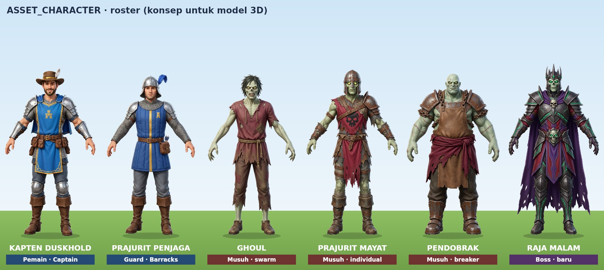
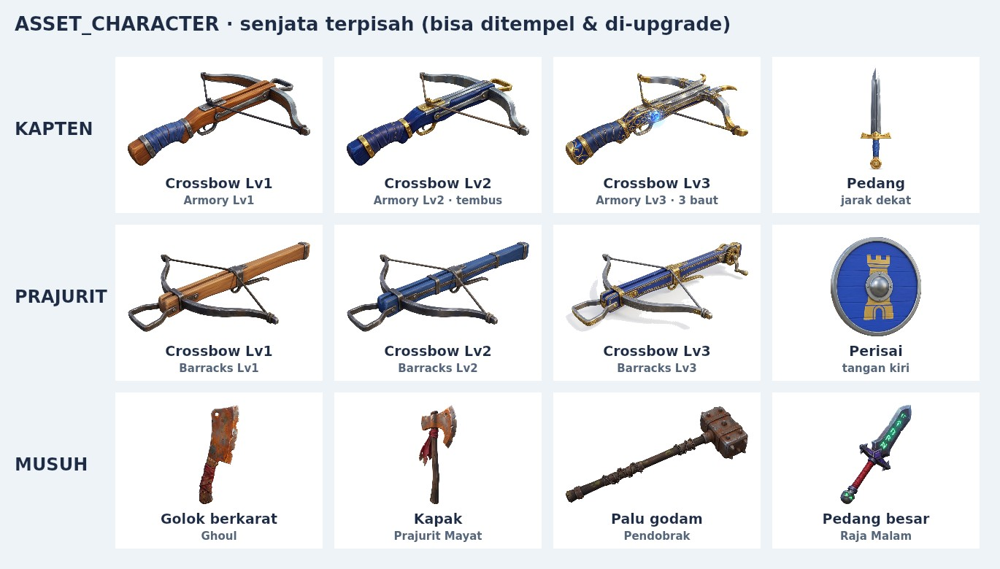
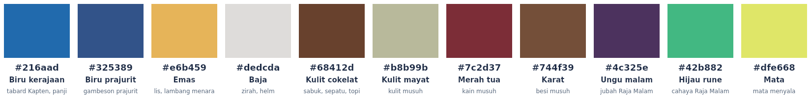

# ASSET_CHARACTER: konsep karakter & senjata untuk model 3D

Permintaan user (2026-10-17):

- Karakter utama gelap, tidak cocok dengan game yang cerah.
- Buat gambar karakter, pasukan, musuh, dan boss.
- Karakternya manusia, bukan chibi.
- Sesuaikan dengan tema dan warna game.
- Senjata dibuat terpisah agar bisa dianimasikan ke setiap karakter dan bisa di-upgrade.

Semua gambar dibuat untuk alur **gambar → model 3D**. Hunter yang sekarang (`hunter_run_walk_claw_sword_shot.glb`) juga dibuat dengan Tripo. Karena itu formatnya seperti ini:

- Karakter berdiri dalam **pose A**, menghadap depan, dan tangannya **kosong**.
- Latarnya putih polos.
- Senjata adalah **gambar sendiri**, satu senjata per gambar.

Dengan begitu senjata bisa dibuat jadi model terpisah dan ditempel ke tangan karakter mana pun.

## Isi folder

| Folder / file | Isi |
|---|---|
| `characters/` | 6 karakter. Gambar asli hasil generate, tidak diubah. |
| `weapons/` | Senjata terpisah per pemilik dan per level. Gambar asli hasil generate. |
| `cutout/` | Versi PNG transparan dari semua gambar di atas, dibuat dengan `tools/asset-cutout.py`. Tepinya bersih dan lubang di dalam crossbow/golok ikut dipotong. |
| `preview/` | `characters.jpg`, `weapons.jpg`, `palette.png`, dibuat dengan `node tools/asset-sheet.mjs`. |
| `prompts.json` | Prompt persis setiap gambar, gambar referensinya, dan statusnya (`generated` / `planned`). |
| `SHA256SUMS.txt` | Checksum gambar asli. |

## Roster

| File | Nama | Peran di game sekarang | Catatan desain |
|---|---|---|---|
| `characters/01-captain-duskhold.png` | **Kapten Duskhold** | Pemain (Hunter / Captain) | Tabard biru kerajaan, lis dan lambang menara emas, zirah baja, topi cokelat dengan bulu putih. Dipilih user dari 2 opsi dan menjadi acuan gaya untuk semua gambar lain. |
| `characters/02-guard.png` | **Prajurit Penjaga** | Guard dari Barracks | Helm baja berjambul biru, gambeson biru dengan garis emas. Dalam game memegang crossbow dan perisai bundar. |
| `characters/03-enemy-ghoul.png` | **Ghoul** | Musuh `swarm` (gerombolan) | Warga yang bangkit dari kubur: kulit hijau pucat, kain merah tua. |
| `characters/04-enemy-undead-soldier.png` | **Prajurit Mayat** | Musuh `individual` (pemburu Kapten) | Rantai berkarat, tabard merah dengan tengkorak. |
| `characters/05-enemy-breaker.png` | **Pendobrak** | Musuh `breaker` (penghancur gerbang) | Badan besar tetapi proporsinya tetap manusia. Pelat besi berkarat, celemek kulit. |
| `characters/06-boss-night-lord.png` | **Raja Malam** | Boss (belum ada di game) | Zirah besi gelap, jubah ungu, rune hijau menyala. |

## Senjata dan level upgrade

| Pemilik | Lv1 | Lv2 | Lv3 | Lainnya |
|---|---|---|---|---|
| Kapten (Armory: Hunter Lv1–3) | `captain-crossbow-lv1` ✅ | `captain-crossbow-lv2` ✅ (Lv2: baut tembus) | `captain-crossbow-lv3` ✅ (Lv3: kipas 3 baut) | `captain-sword` ✅ (jarak dekat, klip `sword`) |
| Prajurit (usulan: ikut level Barracks) | `guard-crossbow-lv1` ✅ | `guard-crossbow-lv2` ✅ | `guard-crossbow-lv3` ✅ | `guard-shield` ✅ (tangan kiri) |
| Musuh | `ghoul-cleaver` ✅ (Ghoul) | `undead-soldier-axe` ✅ (Prajurit Mayat) | `breaker-maul` ✅ (Pendobrak) | `night-lord-greatsword` ✅ (Raja Malam) |

✅ sudah dibuat. Semua **12 senjata** kini ada: 5 dibuat 2026-10-17, 7 sisanya 2026-10-18 (prompt di `prompts.json`, tidak diubah dari rencana). Lv2 dan Lv3 dibuat dari gambar Lv1 sebagai referensi, supaya bentuk dasarnya sama dan hanya bertambah detail.

Catatan hasil: crossbow Kapten Lv3 terbaca sebagai versi mewah (biru-emas, permata biru), tetapi **tiga alur baut tidak terlihat jelas** di gambar. Saat dimodelkan, tambahkan dua alur di kiri-kanan rel. Crossbow prajurit Lv3 punya sedikit bayangan abu di bawah busur; versi `cutout/` tetap bersih di tepinya.

Desain level mengikuti aturan game yang sudah ada. Armory Lv2 membuat baut **menembus** satu musuh, jadi Lv2 dibuat lebih kokoh. Lv3 menembakkan **3 baut sekaligus**, jadi Lv3 dibuat sebagai crossbow tiga alur.

## Palet warna

Warna diambil dari gambar dan dicocokkan dengan dunia KayKit: panji biru, lis emas, batu abu, dan kayu cokelat.

| Warna | Hex | Dipakai untuk |
|---|---|---|
| Biru kerajaan | `#216aad` | Tabard Kapten, panji |
| Biru prajurit | `#325389` | Gambeson prajurit |
| Emas | `#e6b459` | Lis, lambang menara |
| Baja | `#dedcda` | Zirah, helm |
| Kulit cokelat | `#68412d` | Sabuk, sepatu, topi |
| Kulit mayat | `#b8b99b` | Kulit semua musuh |
| Merah tua | `#7c2d37` | Kain musuh |
| Karat | `#744f39` | Besi musuh |
| Ungu malam | `#4c325e` | Jubah Raja Malam |
| Hijau rune | `#42b882` | Cahaya Raja Malam |
| Mata | `#dfe668` | Mata musuh yang menyala |

Kawan memakai biru, emas, dan baja. Musuh memakai hijau pucat, merah tua, dan karat. Dengan pembagian ini kawan dan lawan langsung terbaca, siang maupun malam.

## Cara pakai ke model 3D (Tripo atau image-to-3D lain)

1. **Karakter:** unggah `characters/<nama>.png` (atau versi `cutout/`) ke *Image to 3D*.
2. **Rig:** pakai *auto-rig humanoid*, lalu tambahkan animasi idle, walk, run, shoot (crossbow 1 tangan), hit, dan death. Hunter lama memakai klip `run`, `walk`, `claw`, `shot`, `sword`. Ekspor sebagai **GLB**.
3. **Senjata:** unggah tiap `weapons/<nama>.png` ke *Image to 3D* **secara terpisah**. Hasilnya satu GLB per senjata. Jangan digabung dengan karakter.
4. **Titik tempel (socket)** supaya satu senjata cocok di semua karakter:
   - Pivot berada di tengah pegangan (grip).
   - Crossbow menghadap **+Z** (ke depan karakter).
   - Bilah pedang, kapak, dan golok mengarah ke **+Y**.
   - Senjata ditempel ke tulang **tangan kanan** (`RightHand` dari auto-rig, atau `handslot.r` pada rig KayKit). Perisai ditempel ke tangan kiri.
5. **Skala nyata** (sebelum skala aktor ×1.6 di Survival):

   | Senjata | Ukuran |
   |---|---|
   | Crossbow tangan Kapten | ±45 cm |
   | Crossbow prajurit | ±80 cm |
   | Pedang | ±90 cm |
   | Perisai | Ø ±60 cm |
   | Golok | ±40 cm |
   | Kapak | ±70 cm |
   | Palu godam | ±150 cm |
   | Pedang besar | ±170 cm |

6. **Upgrade:** game cukup mengganti mesh senjata di socket yang sama (Lv1 → Lv2 → Lv3). Model karakternya tidak perlu diganti. Pola ini sudah dipakai: guard KayKit memegang `crossbow_1handed.gltf` sebagai file terpisah.

## Status di game

Gambar ini **belum dimuat oleh game**. Game masih memakai model lama sampai GLB baru dari gambar ini tersedia:

- Hunter Tripo untuk Kapten.
- KayKit Knight untuk guard.
- Monster Quaternius untuk musuh.

Begitu GLB-nya ada, karakter bisa diganti per peran tanpa mengubah aturan game.

## Provenance

- Semua gambar di `characters/` dan `weapons/` **dibuat dengan AI**, yaitu alat generate gambar agent Arena, pada 2026-10-17 (6 karakter + 5 senjata) dan 2026-10-18 (7 senjata) atas permintaan eksplisit user. Prompt lengkapnya ada di `prompts.json`.
- Gambar-gambar ini bukan aset pihak ketiga berlisensi. Aturan proyek "tanpa gambar AI" berlaku untuk aset game berlisensi di `assets/`. Folder ini adalah bahan konsep dan input pemodelan, sama seperti `docs/concepts/`, dan tidak dimuat oleh build game.
- `cutout/` dan `preview/` adalah turunan yang dibuat skrip. Gambar aslinya tidak diubah; checksum-nya ada di `SHA256SUMS.txt`.
