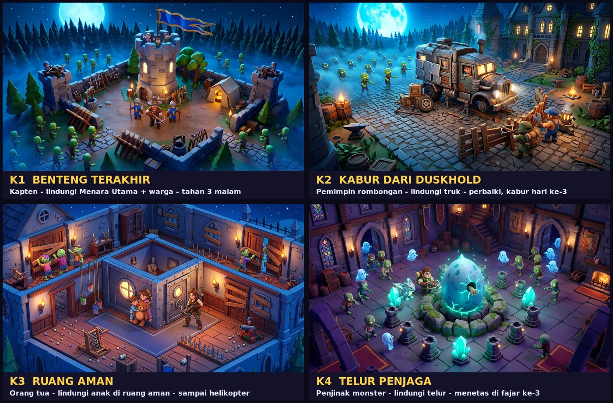
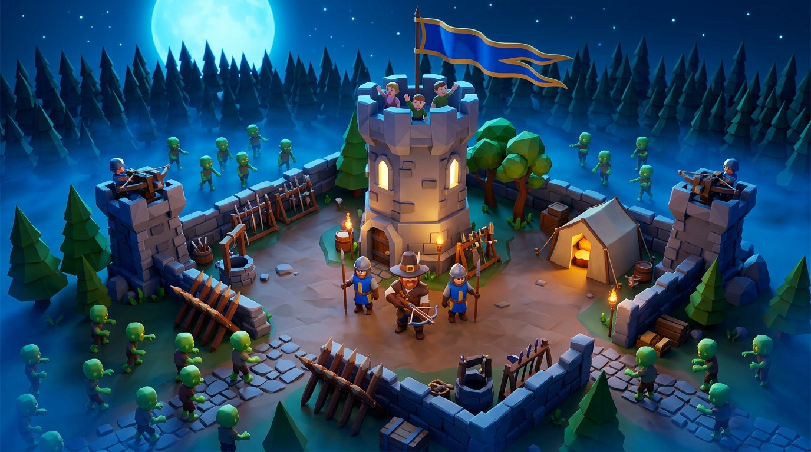
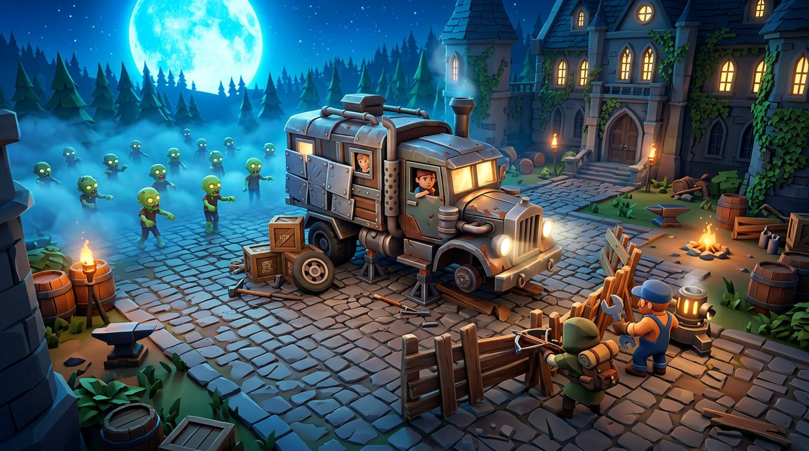
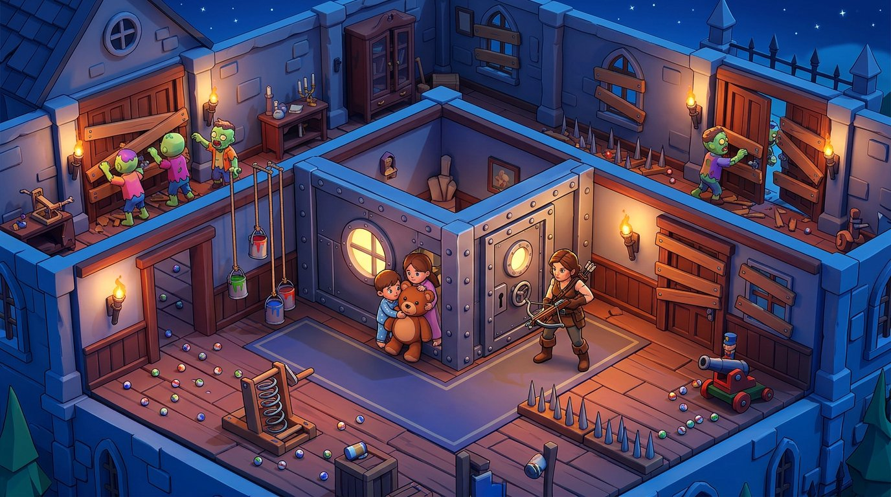
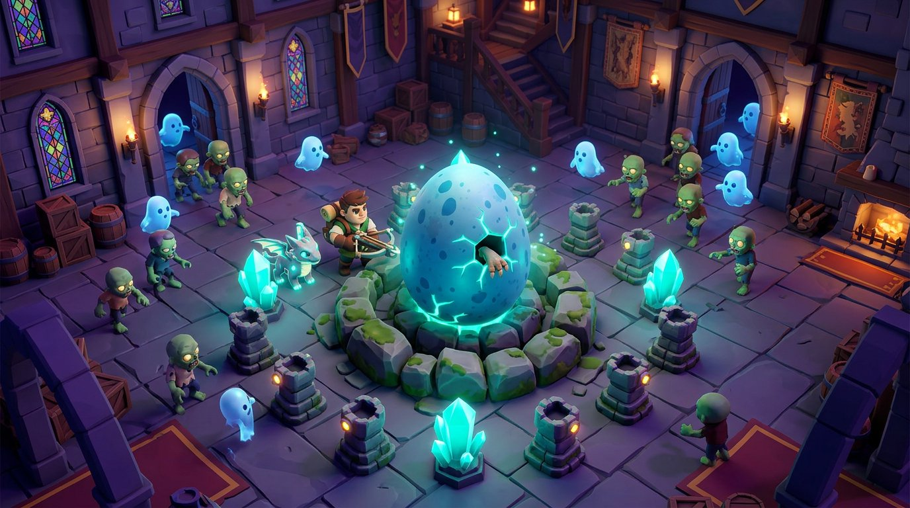
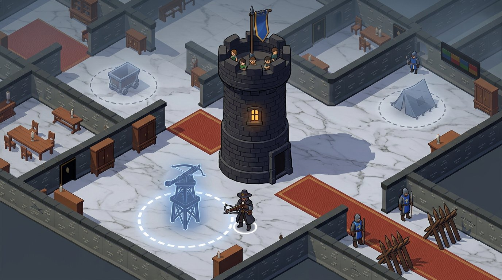

# Brainstorm & Design System Plan — DUSKHOLD Survival (landscape)

**Tanggal:** 2026-10-16 (Asia/Makassar) · **Revisi 2**

**Status:** arah disetujui. **K1 terimplementasi sebagai vertical slice (2026-10-16)** setelah user menyetujui semua rekomendasi dan meminta "pastikan dunianya 3D". Detail implementasi, QA, tuning yang berbeda dari dokumen ini, dan hal yang belum ada ada di `docs/REBUILD-ROADMAP.md` (bagian "K1 Benteng Terakhir — implementasi"). Acceptance manusia/perangkat belum ada. **Revisi dunia (2026-10-16):** atas feedback user ("terasa aneh barack dll ada di dalam ruangan … dunianya disesuaikan"), Survival kini dimainkan di **dunia benteng (bailey)** baru: alternatif "halaman luar" di §3.4.2, yang dulu tidak direkomendasikan, kini dipilih. Mansion hanya dipakai route `?legacy=1`.

**Yang sudah diputuskan user:**
- Game **landscape only**. `manifest.webmanifest` sudah `orientation: landscape`; layout portrait tidak lagi menjadi target desain.
- **Revisi 1 (konsep api) ditolak.** User tidak mendapat *feel* dari "penjaga api" atau apa pun yang berhubungan dengan api. Diminta cerita lain dan referensi build lain.
  - Ringkasan konsep yang ditolak ada di Lampiran A, supaya tidak diusulkan ulang.
- **Revisi 2 — dipilih user (2026-10-16):**
  - konsep **K1 "Benteng Terakhir"**;
  - pola build **P1: jalan ke lingkaran + `BUILD`** (Duck Survival);
  - nada visual **dark stylized, seperti sekarang**.
  - Spesifikasi awal K1 ada di §3.4. Aturan pengganti di §3.4.5 dan 8 keputusan di §13 **disetujui user (2026-10-16)**, dengan syarat tambahan: dunia harus 3D.

**Gambar konsep:** `docs/concepts/` berisi moodboard yang dibuat AI (generate image) untuk brainstorming.
- Gambar ini **bukan aset game** dan tidak masuk build.
- Gaya akhirnya tetap harus dibuat dengan pipeline dan provenance aset yang berlaku.
- `k1`–`k4` dan `overview.jpg` bergaya cozy dan hanya menjadi referensi **cerita & komposisi**.
- Referensi **nada** adalah `k1-mockup-dark-day.jpg` (dibuat dengan referensi screenshot game sekarang + key art DUSKHOLD) dan key art itu sendiri.

**Hubungan dengan roadmap:**
- `docs/REBUILD-ROADMAP.md` tetap mencatat status implementasi & QA.
- Dokumen ini adalah arah desain untuk pass berikutnya; aturan laporan di roadmap tetap berlaku.



---

## 0. Ringkasan

1. **Masalah inti: game belum bercerita.**
   - Pemain tidak melihat siapa dirinya, apa yang dilindungi, dan apa tujuannya.
   - Sekarang semua disampaikan lewat teks (`PROTECT THE FIRE!`) dan angka Oil. Api sebagai pusat cerita **tidak berhasil** dan sudah ditolak user.
2. **Revisi 2 menawarkan 6 konsep tanpa api** (§3).
   - Masing-masing punya **jantung base**: objek pusat yang dilindungi dan terlihat jelas di layar.
   - Empat di antaranya punya gambar konsep.
3. **Dipilih user: K1 "Benteng Terakhir"** (§3.4). Kamu kapten Duskhold. Lindungi **Menara Utama** dan warga di dalamnya, lalu tahan 3 malam sampai bala bantuan datang.
   - Paling dekat dengan key art DUSKHOLD (menara, barikade, horde di kabut).
   - Paling dekat dengan referensi user Duck Survival (benteng, tembok, turret, pasukan).
   - Nada visual: **dark stylized seperti sekarang**, dengan UI tetap terang dan ikon besar.
4. **Build/upgrade punya satu alur**: Pilih → Pratinjau → Bangun → Rayakan → Hasil terlihat malam ini → Kredit saat fajar.
   - **Dipilih user: P1.** Seperti di **Duck Survival**, pemain **menggerakkan karakternya ke lingkaran yang disorot lalu tap Build** (§7.2, §3.4.7). Pola ini sekaligus menggantikan "+" hijau.
5. **Layout landscape dirancang ulang.**
   - Tanpa seleksi: tidak ada panel di layar siang.
   - Dengan seleksi: strip/tombol kontekstual ≤ 104 px (≤ 28% tinggi) di zona jempol.
   - Bandingkan dengan sekarang: kolom kiri selalu terbuka, ±45% lebar × ±66% tinggi.
6. **Tembakan harus terasa kuat.**
   - Target 1–2 hit per zombie swarm.
   - Lapisan *juice*: hit flash, knockback, angka besar, kill pop, muzzle flash, hit-stop pendek untuk event besar, bass.
   - Upgrade Hunter terlihat: bolt tembus, tembakan ganda.

---

## 1. Diagnosis — kondisi sekarang

Bukti:
- `qa-evidence/survival-progression/land-day-panel.png`
- `qa-evidence/survival-towers/land-day-select.png`
- `qa-evidence/survival-towers/land-tower-day.png`
- `qa-evidence/survival-gap-pass/after-landscape-night-40s.png`
- Kode: `src/game/survival.js`, `src/ui/survival.js`, `src/core/config.js`.

| # | Keluhan user | Yang terlihat sekarang | Akar masalah |
|---|---|---|---|
| 1 | Siapa pemain, apa tujuannya, apa yang dilindungi — tidak terjawab | Malam dibuka langsung dengan gelombang dan banner. Survivor hanya pion biru kecil di pintu, Hunter figur generik. Tujuan 3 malam hanya terbaca dari teks `NIGHT 1`. | Tidak ada momen pembuka, tidak ada "wajah" yang dilindungi, tidak ada penanda tujuan akhir. |
| 2 | Api kurang *feel* (lalu: tidak ada feel dengan apa pun soal api) | Perapian adalah prop 220×70 di dinding atas library, ±(1296, 36), bukan di tengah rumah. Banner `PROTECT THE FIRE!` menutupi api di landscape. Batas cahaya berupa garis kuning tipis. | Pusat cerita yang dipilih (api) tidak kena di user. Eksekusinya juga tipis: diperlakukan sebagai *meter resource*. |
| 3 | "+" hijau tidak dimengerti | 5–6 bubble "+" identik, sekeluarga dengan panah hijau upgrade. Chip `TAP + TO BUILD IN LIT ROOMS`, padahal "lit rooms" tidak terlihat di siang hari. | Penanda tidak memberi tahu *apa* yang bisa dibangun dan *kenapa di situ*. |
| 4 | Card landscape terlalu besar | `daySideColumn()` membuat kolom kiri `min(380 px, 45% lebar)` yang **selalu terbuka** di siang hari. Isinya 4 kartu ±85 px + header + baris `READY`/`NIGHT`, sehingga menutup ±45% × ±66% layar 844×390. | Layout portrait dipindah ke samping, bukan dirancang untuk landscape. |
| 5 | Layout upgrade membingungkan | Panel yang sama dipakai untuk build dan upgrade. `READY` terlihat seperti tombol, padahal itu status builder. `NIGHT 2` sama menonjolnya dengan aksi. Bubble di tepi kanan menumpuk jadi pointer. Ada caption teks (`FIRE RADIUS`, `BOLT DAMAGE`). | Tidak ada hierarki antara aksi utama, info, dan status. |
| 6 | Fungsi build/upgrade tidak terasa | Satuan angka berbeda tanpa penanda: `+6` oil (selama malam), `+7` wood (saat fajar), `+1` survivor (langsung), `16` damage. Dunia hampir tidak berubah setelah membangun. Malam tidak menunjukkan bangunan mana yang bekerja, dan popup fajar tidak mengkredit bangunan. | Efek tidak divisualisasikan sebelum, saat, maupun sesudah dibeli. |
| 7 | Damage tembakan kurang kuat | Hunter 26/32/40 vs swarm 48/54/60 HP. Lv1 butuh 2/3/3 hit di gelap. One-shot hanya terjadi di cahaya pada Lv2 Night 1 atau Lv3. Angka damage 16 px (20 px emas). Tidak ada shake/hit-stop saat hit/kill; kill hanya bersuara. | TTK tinggi + umpan balik tipis. |
| 8 | Dunia belum production | Koridor batu gelap, prop jarang, tidak ada kehidupan (orang, asap, debu), malam berupa tint biru tanpa kontras warna. | Belum ada *art direction* dan *color script* yang mengikat. |

---

## 2. Referensi & pelajaran (riset 2026-10-16)

### 2.1 Cerita & objek yang dilindungi

| Game | Yang dilindungi / tujuan | Pelajaran untuk kita |
|---|---|---|
| **Duck Survival** (referensi user) | Pemain adalah bebek bersenjata yang membangun dan meng-upgrade "Duck Fortress": perkuat tembok, buka laser cannon, pasang umpan bebek peledak. Siang membangun, malam bertahan dari horde sampai fajar. | Fantasi **benteng yang tumbuh + daya tembak** sudah cukup sebagai hook. Tidak perlu api. |
| **Dead Ahead: Zombie Warfare** | Bertahan sambil melindungi **bus penuh orang**; bintang misi berasal dari sisa durability bus; bus dan unit di-upgrade. | Kendaraan berisi orang = jantung yang konkret dan bisa di-upgrade. |
| **Survival Machine** | Base dibangun di atas **mesin raksasa yang bergerak**; siang mengumpulkan & membangun, malam zombie menyerbu mesin. | Base yang juga alat untuk pergi = tujuan + perlindungan dalam satu objek. |
| **Dome Keeper** | Melindungi **kubah**; di sela gelombang menggali resource untuk upgrade/perbaikan; kubah hancur = run berakhir. | Satu objek pusat yang jelas + loop "kumpulkan → upgrade → bertahan". |
| **Plants vs. Zombies** | Pemain berperan sebagai **pemilik rumah** yang mempertahankan rumahnya dari zombie. | "Rumahku sendiri" adalah motivasi universal dan mudah dipahami. |
| **Kingdom Two Crowns** | Mahkota = nyawa; Greed mencuri koin & mahkota; titik bangun tetap, pekerja membangun. | Musuh yang **mencuri** sesuatu bisa dibuat terlihat dan terasa. |
| **Wasteland Life: Survival** | Daya tariknya ada pada **transformasi yang terlihat**: area tertutup menjadi lahan, shelter kecil menjadi base, survivor bergabung. | Setiap build harus mengubah dunia secara nyata. |

### 2.2 Interaksi build/upgrade

| Pola | Referensi | Cara kerja |
|---|---|---|
| P1. Jalan ke lingkaran → tap Build | **Duck Survival** | Di fase siang dunia meredup dan waktu praktis berhenti. Pemain menggerakkan bebek ke **posisi lingkaran yang disorot** lalu tap **Build**. |
| P2. Slot strategis → ring menu | **Kingdom Rush** | Menara hanya bisa dibangun di titik strategis. Tap slot kosong → pilih menara dari ring; tap menara yang sudah ada → menu upgrade/jual. |
| P3. Bar pilihan → tap petak | **Plants vs. Zombies** | Pilih tanaman dari *seed packet* di bar, lalu tap petak rumput untuk menanam. |
| P4. Tahan untuk membayar | **Thronefall**, **Kingdom Two Crowns** | Berdiri di titik bangun dan tahan untuk membayar koin satu per satu (Thronefall), atau jatuhkan koin lalu pekerja membangun (Kingdom). |
| P5. Tap bangunan → ikon aksi | **Clash of Clans** | Tap bangunan memunculkan ikon kontekstual (Info, Upgrade, Finish), bukan panel besar. |
| P6. Grid + merge | **City Defense Z** | Build by day / defend by night; bangunan dan prajurit otomatis *merge* bila ditaruh dengan tepat di grid. |
| P7. Arcade idle | My Perfect Hotel, Wasteland Life (genre arcade idle) | Kontrol joystick; resource dipakai untuk membuka bangunan/zona baru; base berkembang secara visual. |

### 2.3 Visual (dari riset revisi 1, tetap berlaku)

- **Thronefall:** model seperti mainan, palet terbatas per level dengan kontras tinggi, kamera isometrik tinggi.
- **Frostpunk / Whiteout Survival:** jangkauan pusat ditampilkan sebagai overlay melingkar. Pelajaran: wilayah bangun harus terlihat, bukan ditebak.
- **Duck Survival** (screenshot toko): malam terang dan bersaturasi tinggi, pill resource di kanan atas, jam malam di tengah atas, angka damage besar.

---

## 3. Konsep tanpa api (revisi 2)

### 3.1 Prinsip

Setiap konsep wajib menjawab tiga hal dengan **gambar**, bukan teks:
- **siapa saya** (siluet pemain);
- **apa yang dilindungi** (jantung base di tengah layar);
- **apa tujuannya** (penanda progres yang terlihat di dunia).

### K1 — "Benteng Terakhir" (rekomendasi)



- **Siapa saya?** Kapten Duskhold: pemburu ber-crossbow bertopi lebar yang memimpin garnisun kecil. Survivor yang sekarang menjaga pintu menjadi **prajurit**-nya.
- **Apa yang dilindungi?** **Menara Utama (Keep)** di tengah benteng, tempat warga berlindung.
  - Warga terlihat di puncak/jendela menara: melambai saat aman, panik saat menara dipukul.
  - Bendera besar di puncak menara menjadi penanda kondisi.
- **Tujuan?** Tahan 3 malam sampai **bala bantuan** datang. Barisan obor/panji pasukan bantuan mendekat di cakrawala setiap fajar, lalu tiba di fajar ke-3.
- **Jantung base:** HP Menara Utama.
  - Kalah bila menara runtuh atau Kapten tumbang.
  - Upgrade menara (kayu → batu → benteng) memperluas **wilayah bendera** (area boleh membangun).
- **Bangunan (contoh):**
  - tembok/barikade (HP pintu);
  - menara ballista (sudah ada);
  - barak (+prajurit, sudah ada sebagai shelter);
  - tambang/gudang (ekonomi);
  - menara jaga.
- **Kenapa direkomendasikan:**
  - Sama dengan key art DUSKHOLD (menara dengan jendela menyala, barikade kayu runcing, horde di kabut).
  - Sama dengan fantasi Duck Survival (benteng tumbuh + daya tembak).
  - Paling banyak memakai sistem yang sudah ada: guard, menara, gate, builder.

### K2 — "Kabur dari Duskhold" (alternatif kuat)



- **Siapa saya?** Pemimpin rombongan yang terjebak; ditemani mekanik (NPC).
- **Apa yang dilindungi?** **Truk uap lapis baja** di halaman Duskhold, berisi penumpang (wajah terlihat di jendela).
- **Tujuan?** Perbaiki truk dalam 3 hari (mesin → roda → lapis baja), lalu **kabur di fajar ke-3** (adegan truk menerobos gerbang).
- **Jantung base:** HP truk. Setiap komponen yang dipasang terlihat di model **dan** memberi efek (misalnya lampu sorot yang menyilaukan musuh, atau lapis baja yang menambah HP).
- **Kekuatan:** progres tujuan paling jelas — "truknya makin jadi" — sehingga build terasa punya dua makna (bertahan + kabur).
- **Risiko:** nuansa steam/modern di halaman manor gotik; perlu sistem komponen kendaraan dan model truk dengan 3–4 state.

### K3 — "Ruang Aman"



- **Siapa saya?** Orang tua/kakak yang melindungi adik-adiknya.
- **Apa yang dilindungi?** **Anak-anak di ruang aman** di tengah rumah. Pintu ruang aman = HP; anak-anak terlihat lewat jendela bulat.
- **Tujuan?** Bertahan 3 malam sampai **helikopter penyelamat** datang.
- **Bangunan:** jebakan ala *Home Alone* (ember cat berayun, papan pegas, kelereng, meriam mainan), barikade, menara.
- **Kekuatan:**
  - Emosi paling kuat.
  - Jebakan terlihat bekerja, jadi build sangat terasa.
  - Paling cocok dengan level interior yang sekarang (ruangan + pintu).
- **Risiko:** tema anak dalam bahaya lebih sensitif; butuh model anak + jebakan.

### K4 — "Telur Penjaga"



- **Siapa saya?** Penjinak monster muda dengan makhluk kecil pendamping.
- **Apa yang dilindungi?** **Telur raksasa** di aula. Telur bergoyang, retaknya bercahaya, dan kadang ada cakar kecil mengintip.
- **Tujuan?** Lindungi telur 3 malam sampai **menetas** menjadi makhluk penjaga (hadiah dan koleksi).
- **Kekuatan:** lucu, memancing rasa penasaran ("apa yang menetas?"), dan membuka meta koleksi telur/makhluk.
- **Risiko:** nadanya bergeser dari horor ke fantasi lucu; brand DUSKHOLD lebih gelap.

### K5 — "Kamu Monsternya" (tanpa gambar)

- **Siapa saya?** Vampir penguasa Duskhold. Mode legacy repo ini memang berpusat pada vampir.
- **Yang dilindungi:** **peti mati / jantung darah** di crypt.
- **Tujuan:** bertahan sampai **Bulan Darah** di malam ke-3.
- **Siang:** vampir tidur, pelayan yang membangun.
- **Kekuatan:** twist paling unik.
- **Risiko:** identitas pemain dan logika siang/malam berubah total.

### K6 — "Harta Duskhold" (tanpa gambar)

- **Siapa saya?** Pemburu harta.
- **Yang dilindungi:** **brankas emas**. Emas = nyawa = uang, jadi setiap koin yang dipakai untuk bertahan mengurangi cadangan.
- **Musuh:** mencuri emas (seperti Greed di Kingdom Two Crowns).
- **Kekuatan:** mekaniknya paling dekat dengan ekonomi Oil yang sekarang (Oil = bahan bakar + dompet).
- **Risiko:** emosinya paling rendah.

### 3.2 Perbandingan

| | K1 Benteng | K2 Kabur | K3 Ruang Aman | K4 Telur | K5 Vampir | K6 Harta |
|---|---|---|---|---|---|---|
| Emosi | Sedang | Sedang–tinggi | Sangat tinggi | Sedang (lucu) | Sedang | Rendah |
| Tujuan terlihat | Bala bantuan mendekat | Truk makin jadi | Helikopter | Telur makin retak | Bulan Darah | Brankas penuh |
| Power fantasy | Tinggi (pasukan + benteng) | Sedang | Sedang (jebakan) | Sedang | Tinggi | Sedang |
| Cocok key art DUSKHOLD | Sangat | Cukup | Cukup | Kurang | Cukup | Cukup |
| Cocok Duck Survival | Sangat | Cukup | Cukup | Cukup | Kurang | Cukup |
| Perubahan aturan | Sedang | Sedang–besar | Sedang | Sedang | Besar | Kecil |
| Aset baru utama | Menara 3 level, prajurit, bendera | Truk 3–4 state, mekanik | Ruang aman, anak, jebakan | Telur 3 state, makhluk | Vampir, crypt | Brankas, koin |

### 3.3 Konsekuensi aturan bila api dihapus (berlaku untuk semua konsep)

| Aturan sekarang | Pengganti | Catatan |
|---|---|---|
| Kalah bila api padam (Oil = 0) | Kalah bila **jantung base hancur** (HP = 0) | Kalah bila Hunter tumbang tetap berlaku. |
| Musuh di api menguras Oil | Musuh di jantung base mengurangi HP-nya | K6: mencuri emas. |
| Oil terbakar tiap detik (tekanan ekonomi) | Dihapus, atau diganti sesuai konsep | K6 mempertahankannya sebagai emas. |
| Cahaya memperlambat & melemahkan musuh (pilihan user sebelumnya) | **Perlu keputusan ulang** | K1: wilayah benteng/kawat berduri. K2: lampu sorot truk. K3: jebakan. K4: aura kristal. Atau dihapus. |
| Bangun hanya di ruangan terang | Bangun di **wilayah** jantung base | K1 bendera, K2 radius bengkel, K3 ruangan yang sudah dibarikade, K4 aura telur. |
| Resource Oil | Emas / persediaan / scrap / mana (per konsep) | Wood tetap. |
| Upgrade Perapian | Upgrade jantung base | Wilayah lebih luas + transformasi visual. |

Perubahan ini menyentuh aturan inti, save (`save.survival`), harness, bot balance, dan FTUE. Karena itu konsep perlu dipilih sebelum implementasi apa pun.


### 3.4 Arah terpilih — K1 "Benteng Terakhir" (spesifikasi awal)

**Dipilih user (2026-10-16):** K1 + pola build P1 + nada dark stylized seperti sekarang.
- Angka di bawah adalah **titik awal**; semuanya diuji ulang di balance pass.
- Aturan pengganti (§3.4.5) **disetujui user** dan terimplementasi. Yang berubah setelah balance bot: damage cakaran ke menara 12/36/72 (−25%) dan urutan pintu Night 1 `chapel → cellar → front`.



Gambar di atas adalah mockup AI, bukan aset game. Referensinya: screenshot game sekarang (`qa-evidence/survival-towers/land-tower-day.png`) untuk gaya render, dan key art DUSKHOLD (`assets/brand/hero-16x9-clean.jpg`) untuk mood.

#### 3.4.1 Tiga jawaban

- **Siapa saya:** Kapten Duskhold, yaitu Hunter yang sekarang (topi lebar, crossbow, mantel gelap). Survivor menjadi **prajurit** bertabard biru.
- **Apa yang dilindungi:** **Menara Utama** di tengah Main Hall, plus warga yang terlihat di puncaknya.
- **Tujuan:** tahan 3 malam sampai **bala bantuan** tiba di fajar ke-3.
- **Logline** (intro/toko): "Duskhold is the last keep. Hold it for three nights."

#### 3.4.2 Penempatan di peta sekarang

> **Diperbarui 2026-10-16 — dunia benteng dipilih (atas feedback user).** Bangunan K1 di dalam ruangan mansion terasa salah cerita, jadi Survival mendapat level sendiri (`src/game/fortress.js`):
> - **Bailey** 2600×1900 px (±50×37 m) dikelilingi **tembok keliling** bergerigi. Ada 4 **menara sudut** bundar, dan setiap gerbang besar diapit 2 **menara gerbang** dengan jembatan bergerigi dan panji biru.
> - **Menara Utama** berdiri di tengah **inner ward** (0, 0).
> - **9 zona** tanpa tembok di antaranya: inner ward + 4 jalan batu menuju gerbang (bentuk salib), serta 4 halaman rumput di sudut.
> - **Gerbang:** gerbang utama di selatan (menghadap kamera, HP 260), gerbang utara/timur/barat (200), dan postern barat laut/tenggara (110).
> - **Hutan** di luar tembok menjadi asal gerombolan.
> - **Wilayah panji tumbuh per zona:** Lv1 inner ward + 4 jalan (5), Lv2 + 2 halaman postern (7), Lv3 + 2 sudut terakhir (9).
> - Setiap zona punya 1 lingkaran ekonomi di luar badan jalan. Setiap zona bergerbang punya 1 lingkaran ballista di dalam gerbangnya (15 lingkaran).
>
> Teks di bawah ini adalah rencana awal di Main Hall (masih berlaku untuk route `?legacy=1`, tidak lagi untuk Survival).

Main Hall (0,0 · 880×620) adalah **hub** denah cross-wing (`src/game/mansion.js`). Dining (barat), library (timur), study (utara), dan basement (selatan) terhubung langsung ke hall.

Usulan penempatan:
- Menara Utama berdiri di **tengah Main Hall**, ±(440, 310).
- Tapak ±260×260; tinggi ≤ 2× dinding.

Akibatnya:
- **Jalur musuh terbaca.** Ketujuh pintu luar (servant, front, cellar, chapel, scullery, palisade, postern) bermuara ke hub.
- **Front door** ada di dinding selatan hall (x = 100), jadi rute ini paling pendek.
  - Jadikan "gerbang utama": barikade + 1 prajurit awal.
  - HP pintu dan posisi guard perlu di-balance.
- **Perapian lama** di library, ±(1296, 36), dihapus atau menjadi dekorasi biasa. Library menjadi ruangan biasa.
- **Kamera:** menara yang tinggi bisa menutupi study (utara), jadi menara **memudar** saat menutupi Hunter/musuh.

**Alternatif (dulu tidak direkomendasikan; dipilih user 2026-10-16):** halaman luar seperti gambar konsep K1, dengan level baru. Kini terimplementasi sebagai dunia benteng (lihat kotak di atas).

#### 3.4.3 Level & status Menara Utama

| Level | Visual | Efek (usulan) |
|---|---|---|
| Lv1 | Menara batu gelap, panji kecil, 3 warga di puncak | Wilayah = hall + 4 ruangan tetangga |
| Lv2 | Batu lebih rapi, panji besar, lonceng di puncak | Wilayah + ruangan sayap; HP naik |
| Lv3 | Benteng: crenel penuh, 2 panji, ballista di atap | Seluruh rumah; HP naik; ballista atap ikut menembak (opsional) |

HP per level ditentukan di balance pass. Angka awal untuk diuji: 600 / 900 / 1200.

| Status | Menara | Warga | Audio / HUD |
|---|---|---|---|
| Aman | Panji tegak | Melambai | Ambience tenang |
| Terancam | — | Menunjuk ke arah musuh | Terompet pendek + pointer tepi |
| Diserang | Bergetar, serpihan batu | Menjerit | Benturan + vignette merah ke arah menara + banner `KEEP UNDER ATTACK!` |
| Kritis (< 25%) | Retak besar, debu, panji robek | Berpelukan | Detak jantung, bar merah berkedip |
| Runtuh | Menara runtuh | — | Layar kalah |

#### 3.4.4 Tujuan: bala bantuan

- **Siang:** di atas layar ada track 3 pip + ikon panji pasukan.
- **Setiap fajar:** panji pasukan maju satu pip (animasi 1 dtk) + `REINFORCEMENTS: 2 NIGHTS`.
- **Fajar ke-3:** pasukan berkuda masuk lewat front door dan horde kabur, lalu layar menang.

#### 3.4.5 Pemetaan aturan (usulan — perlu konfirmasi sebelum koding)

| Sekarang (`SURVIVAL_TUNING`, `survival.js`) | K1 (usulan) |
|---|---|
| Oil awal 38, terbakar 0.14/dtk | **Emas** (koin) awal 38, **tidak terbakar** |
| Kalah bila Oil = 0 atau Hunter tumbang | Kalah bila **HP Menara Utama = 0** atau Kapten tumbang |
| Musuh di api menguras Oil | Musuh di menara memukul HP menara |
| Hadiah malam Oil + Wood 14 / 16 / 18 | Emas + Kayu 14 / 16 / 18 |
| Oil Extractor: +6 / 10 / 14 selama malam | **Tambang emas**: +6 / 10 / 14 selama malam |
| Sawmill: kayu saat fajar 7 / 11 / 15; pintu +10 / 20 / 30% | **Bengkel kayu** (angka sama) |
| Survivor Shelter: +1 / 2 / 3 | **Barak**: +1 / 2 / 3 prajurit |
| Crossbow Tower: damage 16 / 22 / 30; jangkauan 520 / 580 / 640 | **Menara ballista** (angka sama) |
| Gate: +220 HP (4 oil / 16 wood) | **Barikade runcing** (sama; model seperti key art) |
| Upgrade Perapian: radius 980 / 1560 / 2000; biaya 12/8 lalu 18/12 | **Upgrade Menara Utama**: wilayah + HP; biaya sama sebagai awal |
| Cahaya: musuh menerima damage ×1.5, gerak ×0.8, serangan ×0.5 | **Wilayah panji**: musuh di dalam wilayah menerima damage ×1.5 (moral pasukan). Perlambatan dan pelemahan serangan dihapus; efek pelambat datang dari barikade |
| Bangun hanya di ruangan terang | Bangun di lingkaran di dalam **wilayah panji** |
| Tekanan ekonomi dari Oil yang terbakar | **Perbaikan saat fajar**: HP menara pulih sebagian gratis, sisanya dibayar kayu |
| Chip `TAP + TO BUILD IN LIT ROOMS`; banner `PROTECT THE FIRE!` | Chip `WALK INTO A CIRCLE TO BUILD`; banner `KEEP UNDER ATTACK!` |

**Tidak berubah:**
- gelombang 66 / 78 / 90;
- aturan guard (jatuh, ditolong, hilang);
- aturan menara;
- Flare;
- chip FTUE lain;
- route `?legacy=1`.

**Cakupan kode nanti** (setelah disetujui):
- `src/game/survival.js`: jantung, target flow field, wilayah, ekonomi;
- `src/ui/survival.js`: HUD, lingkaran, tombol kontekstual;
- `src/game/mansion.js`: model + posisi menara, perapian library;
- `src/core/config.js`: `SURVIVAL_TUNING`;
- migrasi save `save.survival` (oil → emas);
- update harness, devqa, bot, balance.

#### 3.4.6 Lingkaran bangun per ruangan

Data model lama: **1 slot bebas per ruangan** (jenis apa pun, termasuk menara). K1 (terimplementasi) memetakannya menjadi:
- **lingkaran bangunan** (ekonomi/pasukan);
- **lingkaran menara** (hanya di ruangan yang punya pintu luar, dekat pintu tersebut).

Pilihan desain:
- **(a) Lingkaran bertipe (rekomendasi).**
  - Setiap lingkaran punya jenis tetap, dan siluetnya tergambar di lantai, sehingga "apa & di mana" terbaca tanpa teks.
  - Strateginya ada pada lingkaran mana yang diaktifkan dan di-upgrade.
- **(b) Lingkaran bebas.** Berdiri di lingkaran memunculkan strip 3 pilihan (tambang / bengkel / barak).

Contoh pemetaan Lv1 untuk (a). Wilayah Lv1 berisi setiap jenis minimal satu:

| Ruangan | Lingkaran bangunan | Lingkaran menara |
|---|---|---|
| Main Hall | — (Menara Utama) | Front door |
| Dining | Bengkel kayu | Servant door |
| Basement | Tambang emas | Cellar door |
| Library | Barak | — (tidak punya pintu luar) |
| Study | Tambang emas | — |

Lv2/Lv3 membuka ruangan sayap sesuai balance: kitchen (scullery door), gatehouse (palisade/postern), chapel (chapel door), conservatory, oratory, gallery.

#### 3.4.7 P1 secara rinci

1. **Hunter berjalan di siang hari.**
   - Siang tanpa timer (sudah begitu); Hunter dikendalikan joystick kiri.
   - Perlu dicek di kode: siang sekarang dibingkai untuk tap, bukan berjalan.
2. **Penunjuk arah.** Lingkaran terdekat yang terjangkau menyala, plus panah tipis dari Hunter (maksimal 1 sekaligus).
3. **Masuk lingkaran.**
   - Muncul tombol `BUILD` (palu + biaya) di kanan bawah.
   - Model hantu + efeknya tergambar di dunia (ring jangkauan, bar HP pintu, siluet prajurit, jalur emas).
4. **Tap `BUILD`.**
   - Builder (warga berpalu) keluar dari Menara Utama dan berjalan ke lokasi.
   - Ring progres tampil di lokasi.
   - Selesai dengan pop + kilau.
5. **Upgrade.** Berdiri di dekat bangunan yang sudah jadi memunculkan tombol `UPGRADE` (chevron + biaya) + kartu mini 2 stat di atas tombol (≤ 220 × 96 px).
6. **Lingkaran jauh.** Tap lingkaran yang jauh membuat Hunter berjalan otomatis ke sana: lebih cepat, sekaligus membantu aksesibilitas.
7. **Mulai malam.** `NIGHT 2` ada di kanan bawah sebagai tombol sekunder.
8. **Dihapus:** kolom kiri, "+" hijau, dan pill `READY`.

---

## 4. Momen pembuka (10 detik pertama, per konsep)

Pola ini dipakai untuk semua konsep:
- diputar sekali;
- tap di mana saja untuk melewati;
- tanpa tombol tambahan.

| Konsep | Kamera & adegan | Chip |
|---|---|---|
| K1 | Dekat puncak menara: warga melambai, bendera berkibar. Kapten meniup terompet. Kamera mundur: tembok, barikade, horde di kabut. Di tepi peta, ikon pasukan bantuan berjarak "3 malam". | `HOLD THE KEEP FOR 3 NIGHTS` |
| K2 | Truk mogok di halaman (uap menyembur). Penumpang turun, mekanik menunjuk 3 ikon komponen (mesin, roda, baja). Horde muncul. | `FIX THE TRUCK. ESCAPE ON DAY 3` |
| K3 | Anak-anak masuk ruang aman, pintu dikunci, orang tua mengisi crossbow, rumah berderit. | `KEEP THEM SAFE UNTIL MORNING` |
| K4 | Telur bergoyang dan satu retakan bercahaya. Penjinak melindunginya, pendamping kecil mendesis ke arah pintu. | `PROTECT THE EGG. IT HATCHES ON DAY 3` |

Setelah intro: chip FTUE yang sudah ada (move, auto-shot, Flare) tetap dipakai. Di fajar pertama, penanda tujuan maju satu langkah (pasukan bantuan mendekat / komponen terpasang / helikopter di radio / retakan bertambah).

---

## 5. Pilar desain

1. **Satu pandangan, satu cerita.** Setiap layar menjawab: apa yang terancam, di mana, dan apa yang bisa kulakukan.
2. **Jantung base adalah pusat.** Objek yang dilindungi selalu paling dikenali, berada di tengah, dan bereaksi. Status penting terlihat di objeknya dan orang-orangnya dulu, baru di HUD.
3. **Tunjukkan → angka → teks.** Urutannya: dunia (model/VFX), lalu ikon + angka, dan teks 1–2 kata paling akhir.
4. **Setiap pembelian terlihat bekerja**:
   - sebelum: pratinjau;
   - saat: konstruksi;
   - sesudah: dunia berubah;
   - malam: aksi terlihat;
   - fajar: kredit.
5. **Kekuatan harus terasa.** Setiap tembakan berbobot; setiap upgrade menambah sesuatu yang terlihat.
6. **Landscape-first, jempol-first.** Aksi yang sering dipakai ada di zona jempol bawah, info di atas, dan dunia di tengah tidak tertutup.

Hierarki info:

| Prioritas | Malam | Siang |
|---|---|---|
| 1 | HP jantung base | Apa yang bisa dibangun/di-upgrade sekarang |
| 2 | HP Hunter | Resource |
| 3 | Waktu menuju fajar | Progres tujuan (3 malam) |
| 4 | Pintu yang terancam | Mulai malam |
| 5 | Resource | — |

---

## 6. Jantung base (berlaku untuk konsep apa pun)

### 6.1 Penempatan

- Di **tengah** area main dan terlihat dari banyak arah.
- Kamera siang berpusat di sini. Kamera malam selalu bisa menunjuk ke sini lewat penanda tepi.
- Tidak pernah tertutup banner/HUD.
- Implikasi untuk level yang sekarang: jantung base berada di Main Hall (pusat rumah, dekat pintu depan) atau di halaman (K1/K2). Penempatan ini memengaruhi wilayah bangun, jalur musuh, pos guard, dan balance, sehingga diputuskan bersama konsep.

### 6.2 Lima status (bisa dibedakan dalam 1 detik)

| Status | Pemicu (usulan) | Objek | Orang-orang | Audio | HUD |
|---|---|---|---|---|---|
| Aman | HP > 60%, tidak ada musuh dekat | Normal, bendera/lampu tegak | Santai, melambai | Ambience tenang | Bar warna jantung |
| Terancam | Musuh dalam radius dekat | Penanda arah ancaman | Menunjuk ke arah musuh | Drum pelan | Pointer tepi |
| Diserang | Musuh memukul jantung | Bergetar, serpihan, retak baru | Panik, menjerit | Benturan + jeritan | Vignette merah ke arah jantung + banner pendek |
| Kritis | HP < 25% | Rusak berat, asap/percikan | Berpelukan, memanggil | Detak jantung | Bar merah berkedip |
| Hancur | HP = 0 | Runtuh | — | Sunyi | Layar kalah |

### 6.3 Level = transformasi yang terlihat

- **Lv1 → Lv2 → Lv3** harus terlihat dari jauh. Contoh: menara kayu → batu → benteng (K1); truk rusak → beroda → lapis baja (K2).
- Setiap upgrade disertai:
  - burst + sapuan wilayah baru (0.8 dtk);
  - orang-orang bersorak;
  - angka wilayah lama → baru di strip.

### 6.4 Wilayah bangun terlihat

- Wilayah ditampilkan sebagai **gradasi lantai** + penanda tepi sesuai konsep (tiang bendera K1, garis kapur bengkel K2, barikade K3, kristal K4).
- Pola ini mengikuti overlay jangkauan Frostpunk/Whiteout.
- Tapak di luar wilayah tampil abu-abu + gembok + ikon jantung `Lv2`. Ini mengajarkan "upgrade jantung = ruang bangun baru".

### 6.5 Budget performa (mobile, usulan)

- Efek jantung ≤ 40 partikel aktif; maksimal 1 light dinamis untuk jantung; sisanya decal/baked.
- Semua lapisan mengikuti tier kualitas yang sudah ada.

---

## 7. Build & upgrade yang terasa

### 7.1 Kosakata visual — satu bentuk, satu arti

| Bentuk | Arti | Dipakai untuk | Tidak boleh untuk |
|---|---|---|---|
| Lingkaran bangun (cincin putih putus-putus di lantai + siluet/ikon bangunan di dalamnya) | Tempat kosong yang bisa dibangun | Slot di dalam wilayah | Upgrade |
| Palu | Membangun yang baru | Tombol `BUILD`, builder | Upgrade |
| Chevron emas ↑ | Naik level | Badge upgrade, tombol `UPGRADE` | Bangunan baru |
| Hijau | Untung / cukup / konfirmasi | Biaya terjangkau, hasil `+`, centang | Penanda slot |
| Merah | Bahaya / kurang / rusak | Biaya kurang, pintu jebol, musuh | Dekorasi |
| Lingkaran abu-abu + gembok + ikon jantung `Lv2` | Terkunci di luar wilayah | Slot yang belum terjangkau | — |

### 7.2 Pola interaksi — DIPILIH user: P1 (Duck Survival) + P5 untuk upgrade

**Build (P1).** Di siang hari waktu berhenti. Hunter berjalan cepat ke **lingkaran bangun**; lingkaran yang paling dekat menyala.
- Saat Hunter berdiri di dalam lingkaran, muncul **tombol kontekstual `BUILD`** di zona jempol kanan.
- Jika ada beberapa pilihan bangunan, muncul **strip pilihan ringkas** (≤ 104 px).
- Tap memunculkan model hantu + pratinjau efek di dunia, lalu konfirmasi.
- Ini menggantikan "+" hijau dan kolom kartu besar.

**Upgrade (P5).** Berdiri di dekat bangunan atau tap bangunannya memunculkan tombol `UPGRADE`, berisi chevron emas + biaya, ditambah strip sebelum → sesudah (maksimal 2 stat).

**Kenapa P1:**
- Sama dengan referensi user.
- Karakter "melakukan" pembangunan, sehingga build terasa.
- Tidak butuh panel besar di landscape.
- Lingkaran di lantai menjawab "di mana" dan "apa" sekaligus.

**Risiko & mitigasi:** berjalan memakan waktu.
- Siang tanpa timer (sudah begitu) + kecepatan jalan siang lebih tinggi.
- Tap di lingkaran yang jauh membuat Hunter berjalan otomatis ke sana.

**Alternatif:**
- **P2, ring menu ala Kingdom Rush:** paling cepat dan ringkas; tap slot memunculkan 3–4 ikon melingkar. Kekurangan: menutupi dunia di sekitar slot, dan ikon harus dipelajari.
- **P3, bar bawah ala PvZ:** katalog selalu terlihat (bar tipis ±64 px), pilih lalu tap petak. Kekurangan: butuh petak/grid dan bar yang selalu tampil.
- **P4, tahan untuk membayar ala Thronefall:** sangat diegetik tetapi lambat, dan kurang jelas untuk upgrade.

### 7.3 Alur untuk semua: Pilih → Pratinjau → Bangun → Rayakan → Malam → Fajar

1. **Pilih.** Hunter masuk ke lingkaran (P1), atau tap bangunan.
   - Kamera bergeser (300 ms) agar objek berada di area dunia yang tidak tertutup.
   - Objek lain sedikit diredupkan.
2. **Pratinjau.** Model hantu muncul di lingkaran, dan **efeknya digambar di dunia**:
   - menara: ring jangkauan;
   - jantung: wilayah baru;
   - tembok/barikade: bar HP pintu bertambah;
   - barak: siluet prajurit baru di posnya;
   - ekonomi: jalur resource ke gudang/jantung.
3. **Bangun.** Tap `BUILD`.
   - Perancah muncul, dan builder (warga dengan palu) berjalan ke lokasi.
   - Ring progres tampil di atas lokasi, bukan di pill `READY`.
4. **Rayakan.** Saat bangunan selesai:
   - debu + kilau;
   - model "pop" (0.85 → 1.08 → 1.0, 250 ms);
   - ikon efek terbang ke counter HUD;
   - lonceng kecil.
5. **Malam (payoff).** Saat bangunan bekerja, ikon kecil muncul di atasnya (maks 1 ping per bangunan per 3 dtk):
   - menara: angka damage berwarna menara;
   - tembok: percikan saat menahan;
   - ekonomi: resource terbang ke gudang.
6. **Fajar (kredit).** Popup fajar punya baris per bangunan: `Tower 14 kills`, `Mine +6`, `Wall held` (ikon + angka).

### 7.4 Satu tugas per bangunan (peran generik; nama dan model mengikuti konsep)

| Peran | Contoh K1 | Kapan bekerja | Pratinjau | Payoff malam | Kredit fajar |
|---|---|---|---|---|---|
| Ekonomi | Tambang / gudang | Malam atau fajar (ikon satuan) | Jalur resource ke gudang | Resource terbang | `+N` |
| Pertahanan pintu | Tembok / barikade | Malam | Bar HP pintu `+%` | Percikan saat menahan | Pintu bertahan / jebol |
| Pasukan | Barak (shelter sekarang) | Langsung | Siluet prajurit di pos | Prajurit ekstra di pintu | `+1` prajurit |
| Penembak | Menara ballista (sudah ada) | Malam | Ring jangkauan | Bolt + angka damage warna menara | `N` kill |
| Jantung | Menara Utama | Selalu | Wilayah baru tergambar | Wilayah lebih luas | — |
| Hunter | Crossbow Kapten | Malam | Angka damage + efek baru | Efek terlihat (tembus/ganda) | — |

### 7.5 Satuan efek yang konsisten

- Setiap angka efek selalu ditemani ikon *kapan*:
  - **bulan** = selama malam;
  - **matahari** = saat fajar;
  - **petir** = langsung.
- Angka pertama yang dilihat pemain selalu **perubahan** (`+6`, `16 → 22`), bukan total.

### 7.6 Upgrade ringkas

- Maksimal **2 stat**. Setiap stat: ikon + nilai lama → baru + bar pendek yang bagian tambahannya hijau.
- Pip level `●●○` di samping nama.
- Tombol `UPGRADE`: chevron emas + biaya di dalam tombol.
  - Jika resource kurang: biaya merah, tombol abu.
  - Tombol abu tetap bisa ditekan untuk menunjukkan kekurangannya.
- Dunia ikut memperlihatkan perubahannya: ring menara lama + ring baru putus-putus; wilayah jantung yang baru.
- Chip `TAP A GREEN ARROW TO LEVEL UP` diganti ikon chevron emas yang konsisten.

### 7.7 Builder

- **Status di dunia:** builder bebas berdiri di dekat jantung base; saat bekerja ia ada di lokasi dengan ring progres.
- **HUD:** hanya chip kecil `[palu] 1` di dekat resource. Pill `READY` dihapus.

### 7.8 Ketegangan dengan aturan "label = ikon"

- **HUD tetap ikon-only.**
- **Nama 1–2 kata di strip pratinjau:** boleh (`BALLISTA`), karena pemain baru butuh nama untuk memahami fungsinya.
- **Caption stat** (`FIRE RADIUS`, `BOLT DAMAGE`) dihapus, diganti ikon + pratinjau di dunia.
- Usulan ini perlu persetujuan user (§13).

---

## 8. Sistem layout landscape

### 8.1 Target layar

- **Baseline:** 844 × 390. Uji juga 667 × 375, 932 × 430, dan 1024 × 768 (tablet).
- **Safe area:** kiri/kanan `max(16 px, inset notch)`, bawah `max(12 px, inset home indicator)`.
- **Grid & sentuh:** grid 8 px; target sentuh **≥ 44 px** (iOS 44 pt / Android 48 dp); jarak antar-target ≥ 8 px.
- **Skala UI:** mengikuti tinggi layar (390 px = 1.0), dibatasi maks 1.3.

### 8.2 Zona jempol

- **Kiri-bawah:** joystick (malam dan siang, karena P1 berjalan di siang hari).
- **Kanan-bawah:** aksi utama — Flare (malam), `BUILD`/`UPGRADE` kontekstual, `START NIGHT` (siang).
- **Atas:** info saja.
- **Tengah:** dunia, tidak tertutup lebih dari 28% tinggi layar.

### 8.3 Wireframe — malam

```
+------------------------------------------------------------------------+
| [II] [HP ####-]      ( moon ====o==== sun  0:33 )    [oil 36][wood 44] |
|                      [ BASE ########--  | ppl 4 ]                      |
|                                                                        |
| < pintu                  ( dunia: Hunter di tengah )                   |
|   dikepung                                                             |
|                                                                        |
| ( joystick )             [ chip FTUE 1 baris ]               ( FLARE ) |
+------------------------------------------------------------------------+
```

- **Bar jantung base** adalah bar terpenting: di tengah atas, di bawah timeline.
  - Ikonnya mengikuti konsep (menara/truk/pintu/telur).
  - Ikon orang di sebelahnya = yang ikut dilindungi.
- **Banner** ≤ 40 px di bawah bar.
- **Penanda tepi** maksimal 3, di dalam safe area.
- Label resource (`oil`, `wood`) di wireframe hanya placeholder. Untuk K1, `oil` menjadi **emas** (usulan §3.4.5).

### 8.4 Wireframe — siang, Hunter berdiri di lingkaran bangun (P1)

```
+------------------------------------------------------------------------+
| [II]   ( DAY 2 :  N1 [v] - N2 - N3 - goal )            [oil 56 | -19]  |
|                                                        [wood 44][ppl 2]|
|      .--.                                              [palu 1]        |
|     ( () )  lingkaran lain       ( JANTUNG BASE )                      |
|      '--'                                                              |
|                 .-- - - --.                                            |
|                (  HUNTER   )  <- lingkaran aktif menyala               |
| ( joystick )    '-- - - --'                       [ BUILD ] [ NIGHT 2 ]|
+------------------------------------------------------------------------+
```

### 8.5 Wireframe — pilihan bangunan (strip ringkas, hanya bila > 1 pilihan)

```
+------------------------------------------------------------------------+
| [II]   ( DAY 2 ... )                                  [oil 56][wood 44]|
|                                                                        |
|              ( kamera: lingkaran terpilih di tengah area atas )        |
|                 [ model hantu + efek tergambar di dunia ]              |
|                                                                        |
+------------------------------------------------------------------------+
| [MINE][WALL][BARRK][TOWER] | BALLISTA  o o o  | [ BUILD  oil 4 wd 16 ] |
| ikon 56 px + biaya         | [bolt] 16 [moon] |                   (X)  |
+------------------------------------------------------------------------+
```

- Tinggi strip ≤ 104 px (27% dari 390).
- Hanya muncul saat ada pilihan. Bandingkan dengan sekarang: kolom kiri selalu terbuka (±380 × ±257 px).

### 8.6 Wireframe — upgrade

```
+------------------------------------------------------------------------+
| [TOWER]  * * o  | [bolt]  16 -> 22    ####++  | [ ^ UPGRADE          ] |
|                 | [range] 520 -> 580  ####+   | [   oil 6   wood 18  ] |
+------------------------------------------------------------------------+
```

### 8.7 Wireframe — fajar (kredit)

```
+--------------- DAWN : NIGHT 2 SURVIVED ---------------+
|  [skull] 78     [base] 82%       [ppl] 3 (-0)         |
|  [mine] +6      [tower] 14 kill  [wall] held          |
|  [goal] bala bantuan: 1 malam lagi                    |
|                     ( COLLECT )                       |
+-------------------------------------------------------+
```

### 8.8 Anggaran ukuran (aturan keras)

| Elemen | Batas |
|---|---|
| Bar atas | ≤ 48 px |
| Strip siang | ≤ 104 px (≤ 28%); hanya saat ada pilihan; tidak menutupi objek terpilih |
| Tombol kontekstual | ≥ 56 px tinggi, zona jempol kanan |
| Banner | ≤ 40 px, maksimal 1 sekaligus |
| Chip FTUE | 1 baris, maksimal 1 sekaligus |
| Target sentuh | ≥ 44 px |
| Bubble/badge di dunia | ≤ 40 px; hanya untuk objek yang punya aksi |
| Pointer tepi | Maksimal 3; hanya objek yang relevan |

---

## 9. Design tokens & komponen

### 9.1 Warna semantik

| Token | Hex (usulan) | Arti |
|---|---|---|
| `heart` | K1 (dipilih): biru panji `#3E6BFF` | Menara Utama, wilayah panji, dan pihak kita |
| `gain` | `#45D06A` | Untung, cukup, konfirmasi |
| `upgrade` | `#FFD24A` | Naik level (chevron) |
| `danger` | `#FF4D4D` | Bahaya, kurang, rusak |
| `people` | `#5AB8FF` (keluarga biru yang sama, lebih muda) | Warga, prajurit |
| `res-1` | `#FFC93C` | Resource utama (emas/persediaan; menggantikan Oil) |
| `res-2` | `#B07A45` | Kayu |
| `ring` | `#F2F7FF` garis putus-putus, isi 15% | Lingkaran bangun |
| `night` | `#1C2448` | Tint malam, panel |
| `ink` | `#1B1530` | Outline |
| `panel` | `#141228` @ 88% | Latar panel/strip |

Aturan:
- Hijau tidak pernah berarti "slot kosong".
- Emas hanya untuk naik level.
- Biru = pihak kita (menara, wilayah, prajurit, warga); ikon yang membedakan.
- Merah hanya untuk bahaya.

### 9.2 Tipografi

- Satu font display yang tebal dan bulat (font UI yang sudah ada).
- Skala: 12 / 14 / 18 / 24 / 32 / 40.
- Angka selalu lebih besar dari labelnya.

### 9.3 Ikon

- **Tetap:** wood, survivor, hunter, crossbow, shield, moon, sun, skull, medic, hammer.
- **Baru:**
  - ikon jantung base (sesuai konsep);
  - resource utama baru;
  - lingkaran bangun;
  - chevron upgrade;
  - satuan waktu (bulan / matahari / petir);
  - penanda tujuan (pasukan bantuan / truk / helikopter / telur);
  - lingkaran terkunci.
- **Aturan:** siluet terbaca di 24 px, outline ink 2 px, satu warna dominan.

### 9.4 Komponen

| Komponen | Anatomi | State | Tempat |
|---|---|---|---|
| Pill resource | Ikon 28 + angka 18 (+ chip delta) | Normal / bertambah / kurang / dicadangkan | HUD kanan atas |
| Bar jantung | Ikon jantung + bar + jumlah orang | Aman / terancam / diserang / kritis | HUD tengah atas |
| Timeline malam | Bulan → matahari + pip gelombang | — | Tengah atas |
| Track tujuan | 3 pip + ikon tujuan | Selesai / sekarang / berikutnya | Tengah atas (siang) |
| Lingkaran bangun | Cincin putus-putus + siluet bangunan | Tersedia / tak terjangkau / terkunci / aktif | Dunia |
| Badge bangunan | Ikon + pip level + chevron (jika terjangkau) | Idle / bisa upgrade / dibangun / max | Dunia (≤ 40 px) |
| Tombol kontekstual | Ikon + kata kerja + biaya | Aktif / kurang / sibuk | Kanan bawah |
| Strip pilihan | Tile ikon 56 + info + tombol | Build / upgrade | Bawah |
| Banner | Ikon + 1–2 kata | Alarm / info / sukses | Tengah atas |
| Chip hint | Ikon + teks pendek | Tampil sekali | Bawah tengah |
| Floater | Ikon + angka | Damage / kill / dapat / hilang | Dunia |
| Pointer tepi | Ikon + panah | Pintu / prajurit / jantung | Tepi dunia |
| Kartu fajar | Baris ikon + angka + progres tujuan | — | Fajar |

### 9.5 Motion & suara

- **Motion:**
  - UI 150–200 ms, ease-out;
  - pop 250 ms dengan overshoot;
  - floater 0.9 dtk;
  - kamera 300 ms.
- **Reduced motion:** shake & hit-stop mati.

| Event | Suara |
|---|---|
| Bangun / selesai | Ketukan palu / lonceng kecil |
| Upgrade | "Whoomph" + nada naik |
| Resource masuk | Denting |
| Pintu jebol | Dentuman |
| Jantung diserang | Benturan + jeritan warga |
| Jantung kritis | Detak jantung |
| Fajar | Terompet/lonceng + musik lega |

---

## 10. Combat feel — "tembakan harus kuat"

### 10.1 TTK (jumlah hit per zombie swarm)

Sekarang (Hunter 26/32/40; swarm 48/54/60 HP; bonus ×1.5 di zona cahaya):

| Hunter | Biasa N1/N2/N3 | Zona bonus N1/N2/N3 |
|---|---|---|
| Lv1 | 2 / 3 / 3 | 2 / 2 / 2 |
| Lv2 | 2 / 2 / 2 | 1 / 2 / 2 |
| Lv3 | 2 / 2 / 2 | 1 / 1 / 1 |

Target usulan, arah **"horde power fantasy"**:

| Hunter | Biasa N1/N2/N3 | Zona bonus N1/N2/N3 |
|---|---|---|
| Lv1 | 2 / 2 / 2 | 1 / 2 / 2 |
| Lv2 | 2 / 2 / 2 | 1 / 1 / 1 |
| Lv3 | 1 / 2 / 2 + efek Lv3 | 1 / 1 / 1 + efek Lv3 |

- **Contoh hitungan:** damage Hunter 32/40/48 dengan HP swarm tetap sudah memenuhi target.
- **Alternatif:** turunkan HP swarm sambil menambah jumlah ("HP musuh lebih rendah, musuh lebih banyak").
- **Zona bonus:** jika konsep baru menghapus aturan cahaya, kolom "zona bonus" diganti bonus konsep (§3.3) atau dihapus.
- **Risiko:** bot builder sudah menang mudah (roadmap, acceptance #4). Penguatan tembakan **harus** diimbangi tekanan di balance pass yang sama, dengan tetap menghormati batas performa (cap 30 per gelombang, crowd di-instance).

### 10.2 Lapisan juice (urutan prioritas, nilai awal)

| # | Efek | Nilai awal | Kapan |
|---|---|---|---|
| 1 | Hit flash putih | 60 ms | Setiap hit |
| 2 | Knockback + flinch | 14–24 px swarm, 6 px Breaker | Setiap hit Hunter |
| 3 | Angka damage berbobot | 18 px / 24 px (bonus) / 30 px kill; pop 1.4 → 1.0 | Setiap hit |
| 4 | Kill pop | Tubuh terlempar + pecah jadi debu; sisa memudar 6–8 dtk | Setiap kill |
| 5 | Muzzle flash + recoil | 50 ms, mundur 3–4 px | Setiap tembakan |
| 6 | Tracer bolt | Jejak terang 80–120 ms, bolt lebih besar | Setiap tembakan |
| 7 | Hit-stop | 40–60 ms | Kill Breaker/Individual, Flare |
| 8 | Screen shake | 0 hit biasa; 2–3 px kill beruntun; 6–8 px Flare; 4 px pintu jebol | Event besar saja |
| 9 | Audio berlapis | "Thunk" + bass, pitch acak ±8%, tick kill beruntun | Setiap hit/kill |
| 10 | Haptic (jika ada) | 10–20 ms | Kill besar, Flare |

**Sudah ada:**
- floater 16/20 px;
- flinch/stagger singkat;
- shake saat Hunter terluka dan saat jantung (api) diserang;
- suara kill.

**Belum ada:**
- hit-stop;
- kill pop;
- muzzle flash/recoil;
- tracer;
- shake yang diskalakan per event.

### 10.3 Upgrade yang terlihat (ditentukan desain, bukan kartu pilih 1 dari 3)

- **Hunter Lv2:** bolt tembus (menembus 1 tubuh, jejaknya terlihat).
- **Hunter Lv3:** 3 bolt kipas *atau* bolt meledak. Pilih satu (§13).
- **Tower Lv2/Lv3:** model ballista lebih besar, bolt bercahaya.
- **Flare:** ledakan besar + shake + hit-stop + musuh dalam radius terlempar.

### 10.4 Batas

- Juice tidak boleh menyembunyikan ancaman: partikel dibatasi, tidak ada shake untuk hit biasa, dan ada opsi reduced motion.
- Crowd tetap memakai silhouette yang di-instance.

---

## 11. Dunia — art direction menuju production

### 11.1 Arah gaya: dark stylized (dipilih user 2026-10-16)

- **Render dunia = gaya game sekarang:** dinding batu gelap setinggi pinggang, lantai marmer/kayu, karpet merah, furnitur kayu, lilin.
  - Ditingkatkan ke kualitas production: material lebih kaya, prop lebih padat, ada kehidupan.
- **Mood & identitas = key art DUSKHOLD** (`assets/brand/hero-16x9-clean.jpg`): menara batu gelap dengan satu jendela menyala, barikade kayu runcing, kabut, horde siluet.
- **Aturan yang sudah ada tetap berlaku:**
  - UI terang dengan ikon besar;
  - ruangan terang dan terbaca;
  - malam ditunjukkan dengan tint, bukan kegelapan.
- **Referensi nada:** `concepts/k1-mockup-dark-day.jpg` + key art. Gambar konsep cozy (K1–K4) hanya referensi cerita & komposisi.

### 11.2 Color script per fase

| Fase | Suasana | Warna dominan |
|---|---|---|
| Siang | Aman, sibuk | Netral hangat, krem, hijau rumput |
| Senja (2–3 dtk) | Tegang | Oranye → ungu |
| Malam | Bahaya tapi terbaca | Tint biru-ungu + aksen warna jantung |
| Fajar | Lega | Emas |

### 11.3 Identitas tempat & transformasi

- Setiap ruangan/area punya fungsi, 2–3 hero prop, dan warna lantai sendiri.
- Area di luar wilayah tampak terbengkalai (tetap terbaca).
- Area yang dibangun "pulih": rapi, berpanji, hidup — pola transformasi Wasteland Life.

### 11.4 Kehidupan & ambience

- Warga/penumpang/anak-anak bereaksi di jantung base.
- Builder berjalan ke lokasi.
- Prajurit berpatroli.
- Debu melayang; kabut + mata menyala di luar; gagak di siang hari.

### 11.5 Siluet karakter (terbaca pada tinggi ±24 px)

| Karakter | Siluet | Warna |
|---|---|---|
| Hunter / Kapten | Topi lebar, crossbow, jubah | Warna `heart` + gelap |
| Prajurit/guard | Helm kecil, tombak/crossbow | Biru |
| Warga | Lebih kecil, sederhana | Biru muda/krem |
| Swarm | Bungkuk, mata menyala | Hijau-abu |
| Breaker | Besar, bahu lebar | Abu + merah |
| Individual | Tinggi, kurus | Ungu |

### 11.6 Daftar produksi (setelah konsep dipilih)

- **Model:**
  - jantung base 3 level;
  - warga/orang yang dilindungi + idle;
  - builder; lingkaran bangun + perancah;
  - bangunan per peran (3 level).
- **VFX:** status jantung, sapuan wilayah, build pop, hit/kill, tracer, muzzle.
- **Audio:** daftar di §9.5.
- **Aturan aset:**
  - aset baru dicatat provenance-nya;
  - byte aset berlisensi tidak diubah;
  - pipeline WebGL tetap.
  - Gambar konsep AI tidak dipakai sebagai aset.

---

## 12. Rencana bertahap + acceptance

| Fase | Isi | Kode game? | Acceptance (terukur) |
|---|---|---|---|
| 0. Keputusan | Konsep, pola build, nada visual | Tidak | **Selesai 2026-10-16:** K1 + P1 + dark stylized |
| 1. Artefak desain | Konfirmasi aturan §3.4.5 + keputusan §13; mockup K1 siang (sudah: `k1-mockup-dark-day.jpg`) + malam + pratinjau + upgrade + fajar; sketsa Menara Utama 3 level × 5 status; sheet ikon (emas, menara utama, lingkaran, chevron, bulan/matahari/petir, panji bantuan); storyboard intro K1 | Tidak | User menyetujui mockup + aturan |
| 2. Vertical slice | Menara Utama di Main Hall + HP + 5 status; Hunter berjalan di siang hari + lingkaran bertipe (P1) end-to-end; layout landscape; juice tembakan; intro K1. **Terimplementasi 2026-10-16** (semua lingkaran, bukan hanya menara; intro baru berupa banner) | Ya | Tes 3 pertanyaan ≥ 4/5; tes lingkaran ≥ 4/5; harness/devqa/layoutqa hijau; tombol kontekstual di zona jempol, tanpa panel di 844×390 |
| 3. Roll-out | Semua bangunan & upgrade; kredit fajar; level jantung; TTK + balance pass; migrasi save | Ya | Bot + playtest manusia; 0 regresi QA |
| 4. Produksi | Art pass dunia, audio, performa perangkat | Ya | Target 60 fps / minimum 30 fps di perangkat mid-range; review visual di perangkat |

**Definisi tes:**
- **Tes 3 pertanyaan:** setelah 60 dtk pertama, pemain baru ditanya "kamu siapa / melindungi apa / tujuannya apa". Lulus bila ≥ 4/5 menjawab benar tanpa dibantu.
- **Tes lingkaran:** tunjukkan layar siang; pemain menunjuk di mana bisa membangun dan menebak fungsi satu bangunan. Lulus bila ≥ 4/5.
- **Tes tembakan:** rata-rata ≥ 4 pada skala 1–5.

Status acceptance di roadmap tetap berlaku. Dokumen ini tidak mengklaim apa pun selesai.

---

## 13. Keputusan

**Sudah diputuskan user:**
1. Game **landscape only**.
2. Api bukan pusat cerita (revisi 1 ditolak).
3. Konsep **K1 "Benteng Terakhir"** (2026-10-16).
4. Pola build **P1: jalan ke lingkaran + `BUILD`** (2026-10-16).
5. Nada visual **dark stylized seperti sekarang** (2026-10-16).

**Dikonfirmasi user (2026-10-16): semua rekomendasi** (yang dipilih ada di dalam kurung; semuanya sudah ada di kode):

1. **Posisi Menara Utama:** tengah Main Hall (rekomendasi) / halaman luar dengan level baru (§3.4.2). → **Diganti user 2026-10-16: halaman luar, dunia benteng baru** (`src/game/fortress.js`).
2. **Pengganti aturan cahaya:** wilayah panji ×1.5 tanpa perlambatan (rekomendasi) / hapus total / pertahankan ketiga efek sebagai "moral" (§3.4.5).
3. **Resource Oil diganti:** emas (rekomendasi) / nama lain.
4. **Pengganti Oil yang terbakar:** perbaikan menara saat fajar, dibayar kayu (rekomendasi) / tanpa pengganti.
5. **Jenis lingkaran:** lingkaran bertipe (rekomendasi) / lingkaran bebas + strip 3 pilihan (§3.4.6).
6. **Nama di tombol/strip:** nama 1–2 kata boleh (rekomendasi) / ikon saja.
7. **Hunter Lv3:** 3 bolt kipas (rekomendasi) / bolt meledak.
8. **Intro:** sekali di run pertama dan bisa dilewati (rekomendasi) / setiap run.

---

## Lampiran A — Revisi 1: konsep berbasis api (DITOLAK user, 2026-10-16)

**Yang diusulkan di revisi 1:**
- **Penjaga Api:** pemain penjaga api yang melindungi keluarga di sekitar api; api juga suar bagi konvoi penyelamat.
- **Pewaris Duskhold:** memulihkan dan menerangi rumah.
- **Segel Api:** api sebagai segel kuno.
- **Penempatan api:** Main Hall / library / tetap di dinding.
- **Pola build:** strip bawah / ring menu / tahan untuk bayar.

**Jawaban user:**
- **Fantasi:** "cerita lain selain api".
- **Yang dilindungi:** "cari lagi yang lain selain api dan saya tidak ada feel dengan penjaga api dan apa pun yang berhubungan dengan itu".
- **Penempatan api:** "masih belum".
- **Pola build:** "masih belum, cari lagi reference lain".

**Konsekuensi:**
- Api, minyak sebagai bahan bakar, dan "penjaga" sesuatu yang menyala **tidak dipakai lagi sebagai pusat cerita**.
- Bagian revisi 1 yang tidak bergantung pada api tetap dipakai di revisi 2: diagnosis, layout landscape, alur build, tokens, combat feel, rencana bertahap.

---

## Referensi

- **Duck Survival:**
  - panduan pemula BlueStacks: loop build by day / defend by night; siang dunia meredup dan waktu berhenti; gerakkan bebek ke lingkaran yang disorot lalu tap Build; Gold Mine, Survivor Camp, Machine Gun Turret, Infantry Camp;
  - deskripsi QooApp/Uptodown: "Duck Fortress", perkuat tembok, laser cannon, umpan bebek peledak;
  - Google Play `com.mrtgd2us.google`.
- **Dead Ahead: Zombie Warfare:** Backloggd (hancurkan barikade musuh sambil melindungi bus; bintang dari sisa durability bus), TapTap, WayTooManyGames.
- **Survival Machine:** halaman Steam (base di atas mesin bergerak; zombie menyerbu di malam hari).
- **Dome Keeper:** review Third Coast Review dan Oortrain (gali → upgrade → bertahan; kubah hancur = run berakhir).
- **Plants vs. Zombies:**
  - Wikipedia: pemain sebagai pemilik rumah; *seed packet*; resource sun;
  - PvZ Lawn (cara main): tap seed di bar, lalu tap petak.
- **Kingdom Rush:**
  - panduan Steam KR1: menara hanya di titik strategis;
  - panduan Ironhide Kingdom Rush Battles: tap slot, pilih pertahanan, upgrade;
  - deskripsi mod GitHub `kingdom-rush-genesis-eight-towers`: ring build di dalam stage; tap menara untuk menu upgrade/jual.
- **City Defense Z:** halaman Steam (build by day / defend by night, sistem merge di grid, factory/ammo/barracks/lab/house).
- **Arcade idle:** artikel Udonis, ironSource LevelUp, Homa (joystick, buka bangunan/zona dengan currency); **Wasteland Life: Survival** (App Store; transformasi base yang terlihat).
- **Thronefall** (review The Geekly Grind, Namu Wiki, PS3Blog, panduan Steam 3016836199), **Kingdom Two Crowns** (CellularNews, GideonsGaming), **Whiteout Survival** (whiteoutsurvival.wiki/buildings/furnace), **Frostpunk** (diskusi Steam app 323190, Frostpunk Wiki), **Clash of Clans** (Wiki Laboratory): lihat revisi 1.
- **Game feel:**
  - Jan Willem Nijman (Vlambeer), "The Art of Screenshake";
  - artikel egmatic tentang hit-stop 40–80 ms dan reduced motion.
- **UI mobile:** game-ace.com (44 pt / 48 dp, zona jempol, safe area, orientasi dikunci di GDD); parachutedesign.ca (zona nyaman landscape).
