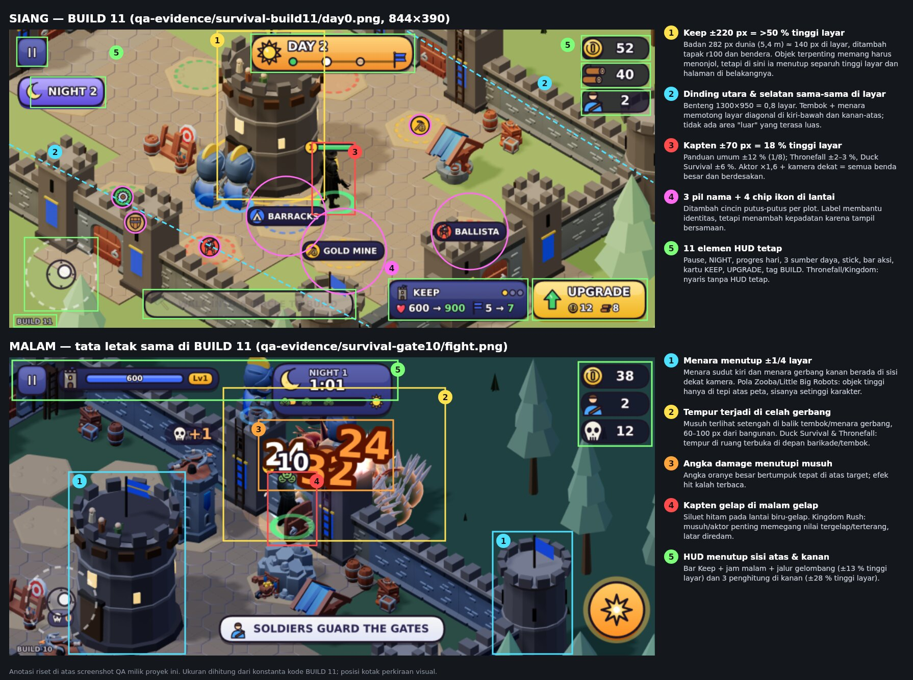
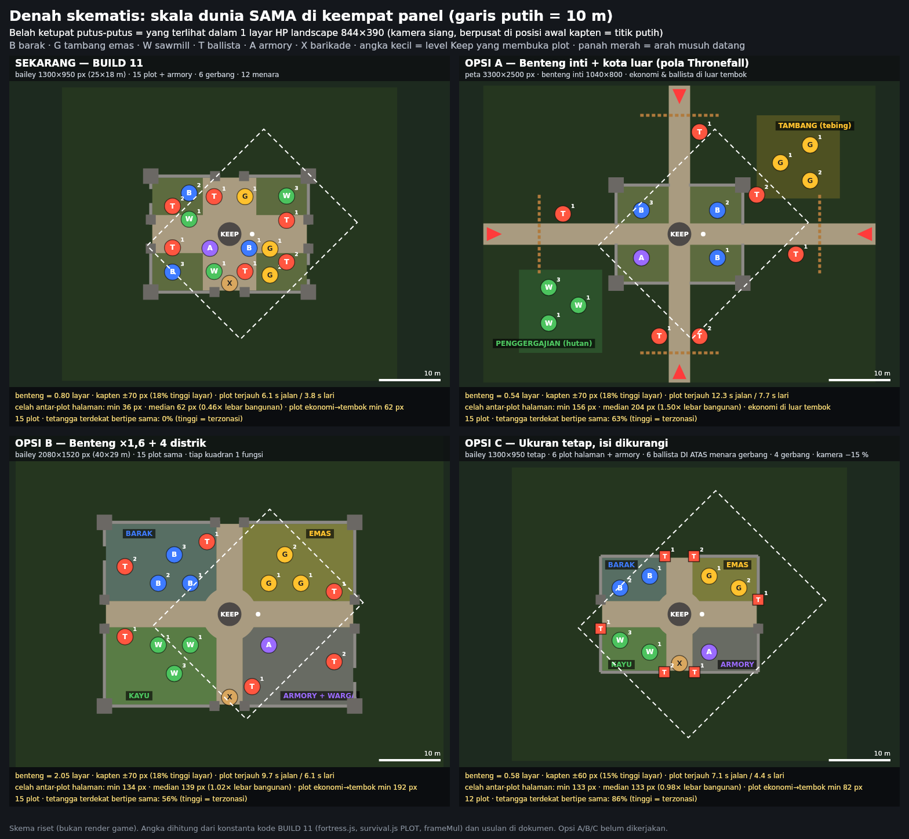

# Riset Visual, Tata Letak & UI/UX: game "bangun siang, bertahan malam" vs DUSKHOLD BUILD 11

**Status (2026-10-17): riset saja. Belum ada perubahan kode game atau tools untuk isi dokumen ini.**

**Pembaruan 2026-10-18:** user memilih **Opsi B** dan meminta peta Rise of Kingdoms dicek dulu, plus kamera yang bisa diperbesar, diperkecil, dan digeser. Hasil cek RoK ada di **§11**. Opsi B + kamera dinamis dikerjakan di **BUILD 12** (lihat `docs/REBUILD-ROADMAP.md`, "Pass BUILD 12"). Isi §0–§10 di bawah ini dibiarkan seperti saat riset (angka "sekarang" = BUILD 11).

Permintaan user setelah BUILD 11: *"masih sama ukuran world nya, tata letak bangunan masih sama, coba kamu research dulu visual game building dan combat seperti ini jangan coding dulu, cari detail ui ux dan visual nya, bandingkan dengan game ini"*.

Usulan di §6–§7 **belum dikerjakan**. Pengerjaan menunggu pilihan user (§9).

**Gambar pendukung** (dibuat untuk riset ini, bukan render game):
- `docs/research/build11-annotated.jpg`: screenshot QA kita (siang BUILD 11, malam dengan tata letak yang sama) beserta anotasi masalahnya.
- `docs/research/visual-layout-options.png`: denah skematis "sekarang" dan opsi A/B/C pada **skala dunia yang sama**, plus luas 1 layar HP.

Screenshot game lain **tidak disimpan di repo** (hak cipta pihak ketiga); semuanya ditautkan di §10.

---

## 0. Ringkasan

### 0.1 Kenapa BUILD 11 terasa "masih sama"

BUILD 11 mengubah lapisan **dekorasi**: warna per jenis bangunan, label, cincin, dan jumlah props. Tiga hal yang membuat dunia terasa sempit **tidak berubah sama sekali**: ukuran bailey, posisi 15 plot, dan zoom kamera sama persis dengan BUILD 10.

1. **Benda terlalu besar dibanding layar.**
   - Kapten ±70 px, yaitu **18 % tinggi layar** HP landscape (390 px). Keep tampil ±220 px (>50 % tinggi layar).
   - Pembanding: Thronefall ±2–3 %, Duck Survival ±6 %, panduan umum ±12 % (1/8 tinggi layar).
2. **Seluruh benteng muat dalam ±1 layar.**
   - Lantai yang terlihat dalam satu layar siang ≈ 1,54 juta px², yaitu **1,25× luas bailey** (1300×950). Jadi benteng = 0,8 layar.
   - Dari posisi awal kapten, dinding utara dan selatan sama-sama terlihat.
   - Akibatnya 15 plot, Keep, 12 menara, dan 6 gerbang selalu bersaing di satu layar. Kamera "mengikuti" kapten, tetapi hampir tidak terasa bergerak, sehingga dunia terasa kecil.
3. **Jarak sempit dan jenis bangunan tercampur.**
   - Celah antar-plot: median 62 px = **0,46× lebar bangunan**, minimum 36 px.
   - Jarak plot ke dinding hanya 62 px.
   - **0 %** plot punya tetangga terdekat yang sejenis. Tambang, sawmill, barak, dan ballista diselang-seling di 9 zona, jadi posisi tidak memberi petunjuk fungsi.

Ditambah dua masalah hierarki visual:

4. **Terlalu banyak warna jenuh yang berebut perhatian**: bangunan biru/kuning/hijau/merah, pil label, spanduk biru, angka damage oranye. Thronefall justru memakai satu palet per level dan membedakan bangunan lewat **siluet**.
5. **Warna tim bertabrakan dengan warna jenis bangunan.** Merah dipakai untuk ballista (milik kita) dan juga identik dengan musuh/bahaya. Thronefall konsisten: musuh merah, unit sendiri biru ([elliotcsmith](https://www.elliotcsmith.com/thronefall/)).

### 0.2 Apa yang dilakukan game sejenis (detail di §2)

- **Thronefall** (paling mirip; kini juga ada di iOS/Android):
  - map lebih besar dari layar, kamera tinggi seperti diorama;
  - kastel berlapis: luar tembok / depan kastel / dalam kastel;
  - satu palet per level, siluet + outline;
  - info bangunan muncul saat raja mendekat;
  - ikon arah dan jumlah musuh di tepi layar sebelum malam;
  - HUD nyaris tidak ada.
- **Duck Survival** (referensi awal user):
  - base berupa lingkaran besar, menara berjauhan;
  - horde tertahan di luar barikade, jadi tempur terjadi di ruang terbuka;
  - bebek putih kontras di lantai gelap.
- **Kingdom Rush**: titik bangun berupa lingkaran kosong di samping jalur; latar diredam, musuh memegang nilai paling gelap/terang.
- **Kingdom Two Crowns / Bad North**: UI hampir nol; keterbacaan adalah nilai seni utama.

### 0.3 Usulan singkat (§6–§7)

| Opsi | Inti | Ukuran world | Celah median | Benteng vs layar | Biaya |
|---|---|---|---|---|---|
| **B (rekomendasi)** | Bailey ×1,6, **15 plot sama** dikelompokkan per kuadran: barak NW, emas NE, kayu SW, armory+warga SE, ballista di gerbang | 2080×1520 px (40×29 m) | 1,02× lebar bangunan | 2,05 layar | sedang |
| A | Pola Thronefall: benteng inti kecil + tambang, sawmill, dan ballista **di luar tembok**; palisade di jalan masuk | peta 3300×2500 px | 1,50× | inti 0,54 layar, kota ±3 layar | besar |
| C | Ukuran tetap, isi dikurangi; ballista naik ke menara gerbang; kamera −15 % | tetap 1300×950 | 0,98× | 0,58 layar | kecil, **tetapi ukuran world tidak berubah** |

Di semua opsi, disarankan **paket hierarki visual + HUD** (§7):
- palet lingkungan diredam;
- merah khusus untuk musuh/bahaya;
- label hanya saat dekat;
- HUD tetap ≤ 6–7 elemen;
- objek tinggi tidak di sisi dekat kamera;
- area tempur terbuka di depan gerbang;
- kapten menjadi benda paling terang.

---

## 1. Metode & batasan

- **Sumber:**
  - wawancara/postmortem developer (Game Developer, Nintendo UK);
  - review media (Rock Paper Shotgun, New Game Network, Siliconera, Gameindustry, The Geekly Grind, Finger Guns, GamesRadar, PC Gamer, dll.);
  - wiki komunitas (Thronefall wiki, Clash of Clans wiki);
  - halaman toko (Google Play, Steam);
  - artikel desain (wesplays, Emily Miles, joshbauer94, MY.GAMES, Wayline).
- **Screenshot pembanding yang dilihat** (tautan di §10):
  - Thronefall Nordfels hari ke-5 dan Sturmklamm kosong (wiki);
  - Thronefall pertempuran malam (Steam);
  - Duck Survival pertempuran malam (thumbnail gameplay).
- **Game kita diukur dari konstanta kode BUILD 11:**
  - `fortress.js`: `FORT_SCALE`, `BAILEY`, menara, gerbang;
  - `survival.js`: `PLOT`, `frameMul`, `TERRITORY`;
  - `config.js`: `SURVIVAL_ACTOR_SCALE`;
  - `envkit.js`: `PX_PER_METRE` = 51,87;
  - `world3d.js`: tinggi Keep;
  - ditambah screenshot QA 844×390.
- **Luas yang terlihat dalam satu layar** dihitung dari proyeksi `ISO_CAMERA`: luas lantai = lebar × tinggi layar / (0,577 × zoom²).
- **Angka game pembanding adalah perkiraan dari screenshot (±20–30 %)**, bukan data resmi. Yang penting adalah perbandingannya, bukan angka pastinya.
- Kedua gambar di `docs/research/` dibuat dengan skrip sekali pakai (`@napi-rs/canvas`) di luar repo. Angka di denah sama dengan tabel §6.5.
- Ini **bukan playtest manusia**. Penilaian "padat" atau "terbaca" tetap perlu dicek user di HP (§8).

---

## 2. Game pembanding: detail visual & UI/UX

### 2.1 Thronefall (Grizzly Games, 2023–2024): pembanding terdekat

Loop-nya sama dengan kita:
- siang: membangun di titik yang sudah ditentukan;
- malam: raja ikut bertempur bersama menara dan pasukan;
- Castle Center wajib selamat.

Versi iOS rilis Juni 2025 ([Wikipedia](https://en.wikipedia.org/wiki/Thronefall)), dan game ini kini juga ada di [Google Play](https://play.google.com/store/apps/details?id=com.doghowlgames.thronefall&hl=en). Ulasannya "Overwhelmingly Positive", 95 % dari ±11 rb review ([Steam](https://store.steampowered.com/app/2239150/Thronefall/)).

**Tata letak & skala**
- Bangunan sudah ditentukan dan hanya bisa dibangun di slot yang sudah ditentukan. Developer sendiri yang menentukan bentuk akhir kastel ([Game Developer](https://www.gamedeveloper.com/design/mastering-minimalism-and-layering-complexity-with-strategy-game-thronefall)). Setiap titik hanya menerima satu jenis bangunan ([NGN](https://www.newgamenetwork.com/article/2820/thronefall-review/)).
- Kastel Nordfels terbagi **3 area** ([Thronefall wiki](https://throne-fall.github.io/game-content/maps/nordfels.html)):

  | Area | Isi |
  |---|---|
  | Luar tembok | 3 mill, 3 watchtower, 1 archer barracks |
  | Depan kastel | 3 rumah, 4 watchtower, 1 barak |
  | Dalam kastel | 7 rumah, 3 watchtower, 2 barak, Castle Center |

  Totalnya ±27 slot, **lebih banyak dari kita (15)**, tetapi tersebar di area yang jauh lebih luas.
- Yang terlihat di screenshot Nordfels hari ke-5:
  - tembok tipis berbentuk belah ketupat mengelilingi inti kastel, dan di dalamnya masih ada halaman kosong;
  - banyak bangunan berada di luar tembok;
  - setiap mill dikelilingi 4 petak ladang datar, yang menjadi ruang kosong "berisi";
  - antar-kelompok bangunan berjarak 2–4 lebar bangunan;
  - unit hanya ±2–3 % tinggi layar;
  - semua bangunan satu warna (oranye-coklat dan atap krem) dan dibedakan dari bentuknya.
- Map lebih besar dari layar. Keluhan yang muncul justru sebaliknya dari keluhan kita: pemain ingin zoom out untuk melihat seluruh map ([Steam, review negatif](https://steamcommunity.com/app/2239150/negativereviews/?l=english&browsefilter=toprated)).

**Visual**
- Palet sangat terbatas, 3D sederhana. **Siluet** membawa informasi paling banyak, dan ada **outline** di sekitar objek ([Game Developer](https://www.gamedeveloper.com/design/mastering-minimalism-and-layering-complexity-with-strategy-game-thronefall)).
- Gaya dua-nada kontras tinggi; palet berganti per level ([GamesRadar](https://www.gamesradar.com/games/strategy/this-gorgeous-lightweight-strategy-game-with-over-15-000-glowing-steam-reviews-is-finally-officially-out/), [Finger Guns](https://fingerguns.net/games/2023/08/05/thronefall-early-access-review-pc-to-arms/)).
- Kamera iso tinggi seperti diorama perang. Flat shading; bayangan tegas di siang, lebih lembut di malam ([The Geekly Grind](https://www.thegeeklygrind.com/all-posts/thronefall-review)).
- "Structures are recognizable at first glance", dan layar tidak menampilkan banyak opsi rumit ([G2A News](https://www.g2a.com/news/features/thronefall-review-the-ideal-strategy-game-for-the-busy-gamer/)).
- Tempur: musuh berwarna merah khas dan unit kita biru jelas. Layar bisa ramai, tetapi pemain tidak pernah merasa tersesat ([elliotcsmith](https://www.elliotcsmith.com/thronefall/)).
- Pelajaran dari kelemahannya: jenis unit sulit dibedakan hanya dari bentuk, sampai patch menambahkan ikon jenis di atas unit ([NamuWiki](https://en.namu.wiki/w/Thronefall)).

**UI/UX**
- Pondasi kecil tersebar di map. Saat raja mendekat, muncul outline bangunan dan slot koin; koin "melayang" ke slot ([Gameindustry](https://www.gameindustry.com/reviews/game-review/enjoy-minimalist-base-building-and-castle-defense-in-thronefall/), [RPS](https://www.rockpapershotgun.com/tower-defence-citybuilding-has-reached-its-peak-with-the-adorable-but-deadly-thronefall)).
- Satu tombol memunculkan outline hantu **semua** bangunan yang tersedia, jadi tidak tampil terus-menerus ([NGN](https://www.newgamenetwork.com/article/2820/thronefall-review/)).
- Sebelum malam, ikon di tepi layar dekat titik masuk menunjukkan arah, jenis, dan jumlah musuh ([Gameindustry](https://www.gameindustry.com/reviews/game-review/enjoy-minimalist-base-building-and-castle-defense-in-thronefall/), [Siliconera](https://www.siliconera.com/review-thronefall-is-a-beautifully-simplistic-rts-game/)).
- Bangunan yang hancur di malam hari dibangun ulang gratis keesokan pagi ([GameSpew](https://www.gamespew.com/2023/08/thronefall-is-your-new-favourite-minimalist-strategy-game/)).
- "Very little HUD to distract you" ([Finger Guns](https://fingerguns.net/games/2023/08/05/thronefall-early-access-review-pc-to-arms/)).

### 2.2 Duck Survival (Joy Games, mobile): referensi awal user

- **Siang:** dunia meredup dan waktu berhenti. Bebek berjalan ke lingkaran yang disorot lalu menekan Build ([BlueStacks](https://www.bluestacks.com/blog/game-guides/duck-survival/dks-beginners-guide-en.html)).
- **Malam:** horde besar masuk dari tepi layar ([BlueStacks](https://www.bluestacks.com/blog/game-guides/duck-survival/dks-beginners-guide-en.html)). Pemain memasang turret dan memperkuat barikade "to funnel the horde" ([Uptodown](https://duck-survival.en.uptodown.com/android), [Google Play](https://play.google.com/store/apps/details?id=com.mrtgd2us.google)).
- **Screenshot malam** (portrait):
  - lingkaran batas base besar, sebagian keluar layar;
  - 4 menara berkaki dengan jarak 2–3 lebar menara;
  - barikade kayu pendek di garis depan, horde **di luar** barikade;
  - bebek putih ±6 % tinggi layar di lantai gelap, sehingga kontras tinggi;
  - angka damage putih banyak (bahkan di sini angka mulai menutupi aksi);
  - ikon bos dan skill di kolom kanan.
- **Pelajaran:** area tempur adalah ruang terbuka di depan barikade, dan menara tidak menghalangi pandangan.

### 2.3 Kingdom Rush (Ironhide, mobile TD)

- Titik bangun ditandai lingkaran kosong; tombol bulat ramah jempol; ikon jelas ([Emily Miles](https://emilym.space/thumbelina-hurts-mobile-ui-blog/2018/6/26/kingdom-rush-a-tower-defense-trilogy-with-ui-design-approaching-perfection-and-entertainment-worth-missing-bedtime-for)).
- UI berada di luar area main atau menempel pada objek yang dipilih. Menu radial di sekitar titik dinilai sangat baik; jendela info sebesar ±1/4 layar dinilai buruk ([joshbauer94](https://joshbauer94.wordpress.com/2014/11/08/user-interface-analysis-of-tower-defence-games/)).
- Siluet dan warna berbeda per jenis musuh. **Musuh memegang nilai paling gelap dan paling terang; latar memakai rentang nilai yang lebih redam** ([wesplays](https://www.wesplays.com/wes-plays/from-chaos-to-clarity-visual-hierarchy-in-tower-defense-design)).

### 2.4 Kingdom Two Crowns

- Satu-satunya UI yang tampil sepanjang permainan adalah **kantong koin dan slot koin kosong** di atas objek. Tidak ada teks petunjuk ([medium, K. Olszewska](https://medium.com/@kinga.olszewska/how-a-game-that-has-almost-no-hud-elements-engaged-a-ux-ui-designer-for-hours-45d71184205f)).
- Desain "1:1": setiap koin adalah entitas di dunia, bukan angka ([Game Developer](https://www.gamedeveloper.com/design/-i-kingdom-two-crowns-i-and-the-practical-intersection-of-pixel-art-and-roguelike-design)).

### 2.5 Bad North (Plausible Concept; juga ada di mobile)

- "The core value behind the art of Bad North is readability". Semua yang terjadi di pertempuran harus terlihat dan bisa dipahami; grid diskret memudahkan pemain menebak hasil penempatan ([Nintendo UK](https://www.nintendo.com/en-gb/News/2018/April/Interview-Taking-on-hordes-of-invading-Vikings-in-Bad-North-1368315.html)).
- Tidak ada bar HP: jumlah anggota pasukan **adalah** nyawanya ([PC Gamer](https://www.pcgamer.com/bad-north-is-easy-to-pick-up-but-its-a-fiendish-strategy-game/)).

### 2.6 Dawn Defender (mobile, rilis Sep 2026)

- Bangun di siang hari: lumber mill, quarry, menara pemanah. Malam hari, pemain mengendalikan pemanah yang bertarung bersama bangunan pertahanan; bangunan bisa rusak dan perlu diperbaiki ([Google Play](https://play.google.com/store/apps/details?id=com.dawnnight.defender)).
- Ini bukti bahwa genre "build by day, defend by night" dengan hero yang dikendalikan sedang ramai di mobile. Pembeda kita harus datang dari **keterbacaan dan rasa**, bukan dari fiturnya.

### 2.7 Pola tata letak dari game lain

- **Diplomacy is Not an Option:** "Consider your gates… Create kill-zones and fall-back positions"; menara perlu garis pandang yang bersih ([Steam](https://store.steampowered.com/app/1272320/Diplomacy_is_Not_an_Option/)). Ballista butuh garis pandang langsung, jadi idealnya dipasang di menara yang cukup tinggi untuk melihat melewati tembok ([wiki](https://diplomacy-is-not-an-option.fandom.com/wiki/Ballista)).
- **Clash of Clans:** bangunan inti berada di tengah, dikelilingi beberapa kompartemen dan lapisan tembok ([CoC wiki, Layouts](https://clashofclans.fandom.com/wiki/Layouts)).

### 2.8 Prinsip umum

- **Ruang kosong itu aktif.** Area sederhana tanpa rintangan memberi jeda visual dan membentuk hierarki; mata tertarik ke kontras ([salivity](https://salivity.github.io/game-development/article/negative-space-in-action-game-level-design)). Kurangi elemen di layar sampai minimum ([Wayline](https://www.wayline.io/blog/negative-space-in-video-game-design)).
- **Ukuran karakter:** default netral ±1/8 tinggi tampilan ([r/gamedesign](https://www.reddit.com/r/gamedesign/comments/u86w7o/relationship_between_character_size_and_screen/)); Mario modern ±1/8 tinggi layar ([GameDev SE](https://gamedev.stackexchange.com/questions/19615/hero-character-sprite-size-in-comparison-to-tile-size)).
- **Kamera miring yang tidak berputar** ([MY.GAMES](https://medium.com/my-games-company/top-down-shooter-level-design-how-map-design-supports-game-mechanics-6ae39fdd095d), tentang Little Big Robots dan Zooba):
  - geometri tinggi menutupi area di belakangnya, jadi sebagian besar objek layout dibuat **kira-kira setinggi karakter**;
  - aksen besar ditaruh **di tepi atas** peta;
  - bagian bawah layar tertutup kontrol, jadi arah ancaman sebaiknya berada di bagian atas frame.

---

## 3. Pengukuran game kita (BUILD 11)

### 3.1 Angka dunia, kamera, dan kepadatan

| Ukuran | Nilai BUILD 11 | Sumber |
|---|---|---|
| Bailey (halaman dalam tembok) | 1300×950 px ≈ 25×18 m | `fortress.js` (`FORT_SCALE` 0,5) |
| Plot | 15: Lv1 9 (1 barak, 2 tambang, 2 sawmill, 4 ballista), Lv2 +4, Lv3 +2; plus armory dan barikade; lingkaran Ø136 px | `survival.js` `PLOT`, `TERRITORY` |
| Menara / gerbang | 12 menara (4 sudut 130 px, 8 menara gerbang 84 px) / 6 gerbang (4 besar, 2 postern) | `fortress.js` |
| Keep | r100 px; badan ±282 px (5,4 m), +6 % per level; di layar ±220 px termasuk tapak dan bendera | `world3d.js` |
| Dinding | 2 m = 104 px; menara ±1,5–1,7× tinggi kapten | `fortress.js` |
| Kapten | 1,7 m × 1,6 = 141 px dunia, di layar **±70 px siang / ±76 px malam = 18–19 %** dari 390 px | `config.js`, `envkit.js`, `frameMul` |
| Zoom | siang 0,608, malam 0,655; pinch 0,8–1,3× | `survival.js` `frameMul` |
| Lantai terlihat dalam 1 layar | siang 1,54 jt px² → **benteng = 0,80 layar**; malam 1,33 jt px² → 0,93 layar | dihitung |
| Celah antar-plot | min 36 px, median **62 px = 0,46×** lebar bangunan | dihitung (`visual-layout-options.png`) |
| Plot ekonomi/barak ke dinding | min 62 px (komentar kode: "60+ px") | dihitung |
| Tetangga terdekat sejenis | **0 %** | dihitung |
| Plot terjauh dari posisi awal | 6,1 s jalan / 3,8 s lari | dihitung (122 / 196 px/s) |

### 3.2 Riwayat skala: kenapa kita berayun dari "terlalu luas" ke "terlalu padat"

Data diambil dari git dan komentar kode. Zoom siang dihitung untuk sisi pendek 390 px.

| Versi | Bailey | Aktor | Zoom siang | Kapten di layar | Benteng vs 1 layar | Feedback user |
|---|---|---|---|---|---|---|
| Awal (sebelum `2d87448`) | 2600×1900 | ×1,0 | 0,433 | ±31 px (8 %) | 1,63 layar | "benteng awal terlalu besar luas sedangkan component game nya kecil" |
| `2d87448` | 1820×1330 | ×1,25 | 0,552 | ±50 px (13 %) | 1,30 layar | "tidak ada perubahan" *(kemungkinan sebagian karena cache service worker; diperbaiki di BUILD 8)* |
| BUILD 8 `b49ef9a` | 1300×950 | ×1,6 | 0,718 | ±83 px (21 %) | 1,12 layar | kamera minta dijauhkan sedikit dan bisa digeser |
| BUILD 9 `538b033` s/d BUILD 11 | 1300×950 | ×1,6 | 0,608 | ±70 px (18 %) | **0,80 layar** | BUILD 10: "sangat padat… susah fokus dan tidak tau build yg mana"; BUILD 11: "masih sama ukuran world… tata letak masih sama" |

**Pelajaran:**
- Kita sudah mencoba dua kutub:
  - benteng 1,6 layar dengan benda kecil (8 %) terasa kosong;
  - benteng 0,8 layar dengan benda besar (18 %) terasa padat.
- Game pembanding berada di tengah: **dunia lebih besar dari layar, benda tetap terbaca, dan ruang kosongnya dirancang** (ladang, plaza, jalan, cincin terbuka di depan tembok), bukan sekadar halaman kosong.
- Yang perlu diubah adalah **rasio celah/benda dan zonasi**, bukan hanya zoom. Zoom out pada tata letak yang padat tetap terlihat padat; hanya bendanya yang mengecil.

### 3.3 Apa yang terlihat di layar

**Siang** (`qa-evidence/survival-build11/day0.png`):
1. Keep menutup lebih dari separuh tinggi layar.
2. Dinding dan menara memotong layar secara diagonal di kiri-bawah dan kanan-atas.
3. Kapten 18 % tinggi layar.
4. Tiga pil nama dan empat chip ikon di lantai, ditambah cincin per plot.
5. **11 elemen HUD tetap**: pause, NIGHT, progres hari, 3 sumber daya, stick, bar aksi, kartu KEEP, UPGRADE, tag BUILD.

Total ±18 elemen UI tampil bersamaan. `build.png` menambah ghost ballista merah, cincin jangkauan merah, chip petunjuk, dan panah upgrade.

**Malam** (`qa-evidence/survival-gate10/fight.png`; tata letak BUILD 11 sama):
1. Menara sudut dan menara gerbang di sisi dekat kamera menutup ±1/4 layar.
2. Tempur terjadi **di celah gerbang**: musuh setengah tertutup tembok, 60–100 px dari bangunan.
3. Angka damage oranye besar bertumpuk di atas target.
4. Kapten berupa siluet hitam di lantai biru-gelap, jadi kontrasnya rendah.
5. HUD menutup ±13 % bagian atas dan ±28 % kolom kanan.

---

## 4. Perbandingan berdampingan

Angka game pembanding adalah perkiraan dari screenshot.

| Aspek | Thronefall | Duck Survival | Kingdom Rush | K2C / Bad North | **Kita (BUILD 11)** | Akibat selisihnya |
|---|---|---|---|---|---|---|
| Tinggi hero di layar | ±2–3 % | ±6 % (portrait) | kecil | kecil | **18–19 %** | Hero dan bangunan besar, sisa ruang sedikit |
| Dunia vs layar | map > layar; kamera ikut raja | base ±1–1,5 layar; kamera ikut bebek | 1 layar (TD murni) | Bad North 1 pulau kecil; K2C side-scroll panjang | **benteng 0,8 layar** | Semua elemen selalu terlihat sekaligus, sulit fokus, dunia terasa kecil |
| Zonasi | 3 area berlapis; kelompok per fungsi (mill + ladang) | menara di tepi base, kamp di dalam | menara di sepanjang jalur | — | jenis diselang-seling; **0 %** tetangga sejenis | Posisi tidak memberi petunjuk fungsi |
| Ruang kosong | luas: rumput, ladang datar, cincin antara tembok dan kota | lantai luas antar-menara | jalur dan dekor | — | celah 0,46×; 62 px ke dinding | Tidak ada jeda visual |
| Lokasi tempur | di tembok/luar, jauh dari inti | di barikade, ruang terbuka | di jalur | di pantai | **di celah gerbang, di balik menara** | Aksi malam tertutup |
| Objek tinggi | menara ramping, tembok rendah tipis | menara berkaki | menara kecil | — | Keep >50 % tinggi layar; 12 menara termasuk sisi dekat kamera | Oklusi |
| Penanda titik bangun | pondasi kecil, outline + slot koin saat dekat, tombol "lihat semua" | lingkaran disorot | lingkaran kosong + menu radial | slot koin | cincin berwarna per jenis, pil nama 3 terdekat, chip ikon | Polanya sudah mirip, tetapi 9–15 cincin tampil sekaligus |
| Identitas bangunan | siluet, 1 palet, outline | model unik | siluet sangat berbeda (archer, barak, mage, artileri) | — | KayKit hex diwarnai per jenis + label | Warna dipakai untuk jenis, bukan untuk kawan/lawan |
| Warna tim | musuh merah, kita biru | — | musuh paling kontras | — | ballista **merah**, musuh merah/biru/hijau | Kawan/lawan tidak terbaca dari warna |
| HUD tetap | sangat sedikit | wave/bos di atas, skill di kanan | lives/gold/wave di pojok, power di bawah | nyaris nol | **11 elemen + ±7 label dunia** | HUD ikut menambah kepadatan |
| Kontras tempur | unit kecil tapi kontras, ledakan oranye | bebek putih di lantai gelap | musuh paling kontras | — | kapten gelap; angka oranye menutupi musuh | Fokus hilang di malam |
| Siang vs malam | palet hangat vs biru; bayangan tegas vs lembut | malam ungu-gelap | — | — | tint biru, tidak gelap (keputusan user) | OK, pertahankan |

---

## 5. Diagnosis

1. **BUILD 11 tidak menyentuh baris 1–6 tabel §4.** Baris-baris itulah yang menentukan kesan "ukuran world" dan "tata letak". Wajar layar user terlihat hampir sama.
2. **Warna per jenis membantu di satu sisi, tetapi menambah persaingan warna.** Thronefall melakukan kebalikannya: bangunan satu palet, identitas dari siluet dan posisi; warna jenuh hanya untuk kawan/lawan dan hal yang perlu ditindaklanjuti.
3. **Penyebab utama "tidak tahu bangunan yang mana" adalah tidak adanya logika ruang.** Tambang berada di N, E, dan SE; sawmill di S, W, dan NE; barak di ward, NW, dan SW. Di game pembanding, posisi sudah menjelaskan fungsi sebelum label dibaca: mill + ladang di luar tembok, menara di garis depan, rumah di dalam.
4. **Tempur di celah gerbang** membuat malam terasa sempit dan tertutup. Di Duck Survival dan Thronefall, tempur berlangsung di ruang terbuka di depan barikade/tembok. Kita sudah punya aturan "untuk melawan, kapten keluar gerbang", tetapi area di luar gerbang belum dirancang sebagai arena yang lapang dan terbaca.

**Yang tidak boleh diulang:**
- hanya mewarnai ulang;
- mengecilkan semua benda (kembali ke "komponen kecil");
- membesarkan halaman tanpa merancang ruang kosongnya (kembali ke "benteng terlalu luas");
- menambah label baru.

---

## 6. Usulan tata letak (belum dikerjakan)

### 6.1 Target terukur untuk menilai opsi

| Metrik | Sekarang | Target | Alasan |
|---|---|---|---|
| Benteng vs 1 layar (siang) | 0,80 | **1,6–2,5** | Dunia lebih besar dari layar seperti Thronefall/Duck Survival; satu layar ≈ 1–2 distrik |
| Celah median antar-plot | 0,46× | **≥ 0,75–1,0×** lebar bangunan di dalam distrik, ≥ 2× antar-distrik | Jeda visual; bangunan terbaca satu per satu |
| Plot ekonomi/barak → dinding | 62 px | **≥ 150 px** | Cincin terbuka di balik tembok; tempur tidak menempel ke bangunan |
| Tetangga terdekat sejenis | 0 % | **≥ 50 %** | Zona per fungsi |
| Tinggi kapten | 18–19 % | 14–18 % | Tetap besar (benda tidak boleh kecil lagi) tetapi tidak mendominasi |
| HUD tetap | 11 (+±7 label) | **≤ 6–7** (+ label hanya saat dekat) | Thronefall / K2C / Kingdom Rush |
| Plot terjauh | 6,1 s jalan | ≤ 6–7 s lari | Sesi mobile pendek |

### 6.2 Opsi B — "Benteng ×1,6 + 4 distrik" (rekomendasi)

**Ukuran.** `FORT_SCALE` 0,5 → 0,8: bailey **2080×1520 px (40×29 m)**, luas ×2,56. Ukuran bangunan, aktor, dan zoom kamera **tetap**, sehingga benda tetap terbaca dan dunianya yang membesar.

**Isi: 15 plot dengan jumlah dan urutan unlock yang sama** (Lv1 9 / Lv2 +4 / Lv3 +2), dikelompokkan per kuadran:

| Kuadran | Isi | Latar di luar tembok |
|---|---|---|
| NW **BARAK** (biru) | 3 barak (Lv1/2/3) + ballista postern NW | lapangan latihan (boneka latihan, rendah) |
| NE **EMAS** (kuning) | 3 tambang (2× Lv1, 1× Lv2) | tebing/tambang batu |
| SW **KAYU** (hijau) | 3 sawmill (2× Lv1, 1× Lv3) | tepi hutan, tumpukan kayu |
| SE **ARMORY + WARGA** | armory + 2–3 rumah warga rendah (dekor, "yang dilindungi" dalam cerita K1) | — |
| Cincin pertahanan | 6 ballista di samping 6 gerbang (4× Lv1, 2× Lv2) | — |

Keep berdiri di plaza batu r230. Empat jalan selebar 220 px menuju gerbang; sekarang lebar jalannya 450/320 px, jadi jalan kembali terbaca sebagai jalan, bukan lapangan.

**Hasil (dihitung, lihat denah §6.6):**
- benteng = 2,05 layar, ±49 % terlihat sekaligus;
- celah min 134 px / median 139 px (**1,02×**);
- plot ekonomi ≥ 192 px dari dinding;
- tetangga sejenis 56 %;
- plot terjauh 9,7 s jalan / 6,1 s lari.

**Varian ×1,4** (`FORT_SCALE` 0,7, bailey 1820×1330), kalau khawatir terlalu luas:
- 1,57 layar;
- celah median 105 px (0,77×);
- dinding ≥ 160 px;
- plot terjauh 8,5 s jalan / 5,3 s lari.

**Kelebihan:**
- Perubahan yang paling terlihat di layar user, dengan **sistem yang sama**: gerbang, penjaga di menara gerbang, gelombang, `NIGHT_DOORS`, dan aturan sortie.
- Satu layar menampilkan 1–2 distrik, jadi lebih mudah fokus.
- Posisi menjelaskan fungsi; label menjadi pelengkap.

**Risiko & biaya (sedang):**
- **Jarak jalan bertambah ±60 %.** Mungkin perlu lari +15–20 % atau lari otomatis setelah 1 detik berjalan.
- **Risiko "halaman kosong"** seperti keluhan 2026-10-16. Kuadran harus diisi ruang kosong yang dirancang dan **rendah**: ladang, rel tambang, tumpukan kayu, boneka latihan. Jangan menambah objek tinggi.
- Banyak bagian harus disesuaikan dan diukur ulang:
  - posisi plot, menara, gerbang, pos penjaga, tangga, dan postern;
  - flow-field dan navigasi;
  - jarak gerbang ke Keep, yang mengubah balance.
- Semua gate QA harus dijalankan ulang, termasuk balance 5 seed (`harness`, `devqa`, `plotsqa`, `map`, `envqa`, `layoutqa`, `balance`).

### 6.3 Opsi A — "Benteng inti + kota luar" (pola Thronefall)

**Tata letak:**
- Peta ±3300×2500 px.
- Benteng inti **kecil** 1040×800 dengan 4 gerbang, berisi Keep, 3 barak, dan armory: inti militer yang dilindungi.
- Di luar tembok:
  - tambang di tebing NE;
  - sawmill di hutan SW;
  - 6 ballista di 4 jalan masuk;
  - **palisade/barikade** di ujung jalan sebagai garis luar yang bisa dibangun/diperbaiki.
- Musuh datang dari 4 tepi peta, dan ikon arahnya tampil di siang hari.

**Hasil:**
- celah median 1,50×;
- inti 0,54 layar, seluruh kota ±3 layar;
- plot terjauh 12,3 s jalan / 7,7 s lari. Perlu sprint/kuda; Thronefall memakai kuda yang bisa gallop.

**Kelebihan:**
- Paling berbeda dan paling sesuai genre.
- Tempur terjadi di ruang terbuka, cocok dengan aturan "melawan musuh di luar benteng".
- Bangunan di luar bisa diserang. Pola "dibangun ulang gratis keesokan pagi" dari Thronefall memberi drama tanpa menghukum.

**Risiko (besar):**
- hampir menulis ulang peta, target AI, gelombang, penjaga, cerita intro/bala bantuan, dan QA;
- balance dari nol;
- perlu minimap/overview dan ikon arah musuh;
- terrain dan pohon lebih banyak, sehingga performa HP kelas bawah perlu diuji;
- risiko dunia kosong paling besar.

### 6.4 Opsi C — "Ukuran tetap, isi dikurangi"

**Perubahan:**
- Bailey tetap 1300×950.
- 4 menara sudut dihapus; postern ditutup (6 → 4 gerbang).
- **Ballista dipasang di atas menara gerbang**, bukan sebagai plot di halaman. Ini cocok dengan pola DiNaO: ballista butuh menara untuk garis pandang.
- 6 plot halaman (2 barak, 2 tambang, 2 sawmill) + armory, dikelompokkan per kuadran.
- Keep −25 % tinggi; zoom −15 % (kapten ±60 px = 15 %).

**Hasil:**
- benteng 0,58 layar;
- celah 0,98×;
- tetangga sejenis 86 %;
- plot terjauh 7,1 s jalan / 4,4 s lari.

**Kelebihan:** murah, risiko kecil, sistem gerbang hampir tidak berubah.

**Kekurangan:**
- **Ukuran world tidak berubah**, jadi tidak menjawab feedback terakhir.
- Pilihan bangunan berkurang; ekonomi perlu diseimbangkan ulang (3+3 → 2+2 bangunan ekonomi).
- Seluruh benteng tetap terlihat dalam satu layar.

### 6.5 Ringkasan opsi

| | Sekarang | **B ×1,6** | B ×1,4 | A | C |
|---|---|---|---|---|---|
| Bailey / peta (px) | 1300×950 | 2080×1520 | 1820×1330 | inti 1040×800, peta 3300×2500 | 1300×950 |
| Benteng vs layar | 0,80 | **2,05** | 1,57 | inti 0,54, kota ±3 | 0,58 |
| Plot | 15 | 15 | 15 | 15 | 6 + 6 di menara |
| Celah median | 0,46× | **1,02×** | 0,77× | 1,50× | 0,98× |
| Ekonomi → dinding | 62 px | 192 px | 160 px | di luar tembok | 82 px |
| Tetangga sejenis | 0 % | 56 % | 56 % | 63 % | 86 % |
| Plot terjauh (jalan / lari) | 6,1 / 3,8 s | 9,7 / 6,1 s | 8,5 / 5,3 s | 12,3 / 7,7 s | 7,1 / 4,4 s |
| Menjawab "ukuran world" | — | ya | ya | ya, paling besar | **tidak** |
| Biaya | — | sedang | sedang | besar | kecil |

### 6.6 Denah (skala dunia sama, belah ketupat = satu layar HP landscape)

---

## 7. Usulan visual & UI/UX (untuk semua opsi)

| # | Usulan | Dasar riset | Ukuran keberhasilan |
|---|---|---|---|
| V1 | **Hierarki warna.** Lingkungan, tembok, dan bangunan diredam (saturasi rendah, satu palet batu-kayu). Warna jenuh hanya untuk kapten, musuh, titik aksi aktif, dan gerbang yang diserang | Thronefall (palet terbatas, siluet); Kingdom Rush (latar redam, musuh paling kontras) | Di screenshot, mata langsung ke kapten/musuh/titik aksi (uji 5 detik, §8) |
| V2 | **Warna tim konsisten.** Biru = kita (kapten, penjaga, bolt, jangkauan ballista); merah = musuh dan bahaya saja. Ballista tidak lagi merah: pakai aksen baja/kayu + bendera biru. Cincin jangkauan berwarna putih/biru. Warna jenis tetap sebagai aksen atap/bendera + **warna tanah distrik** | Thronefall (musuh merah, kita biru) | Tidak ada objek milik kita yang berwarna merah dominan |
| V3 | **Siluet per peran**, ditambah outline tipis: tambang = rendah-lebar + mulut gua + gerobak; sawmill = roda gergaji besar + tumpukan kayu; barak = aula + bendera + boneka latihan; ballista = menara ramping + busur raksasa | Thronefall (siluet membawa informasi), Kingdom Rush (4 siluet menara) | Dari satu siluet abu-abu, 4 jenis bisa ditebak |
| V4 | **Label hanya saat dekat.** Nama, fungsi, dan biaya muncul saat kapten berada ≤ 1 lingkaran dari titik. Di tempat lain hanya ikon kecil di tanah. Tombol "lihat semua" di siang hari memunculkan semua titik + nama sementara | Thronefall (outline + koin saat dekat; tombol ghost semua bangunan); K2C | ≤ 2 label nama tampil bersamaan |
| V5 | **Diet HUD.** Siang: pause, hari/progres, emas, kayu, tombol aksi kontekstual, stick (6). Kartu KEEP dan UPGRADE hanya muncul saat dekat Keep; tag BUILD disembunyikan di build rilis. Malam: HP Keep, jam/gelombang, emas, tombol serang, stick | Thronefall/K2C (HUD minim); joshbauer94 (panel info besar = buruk) | HUD tetap ≤ 6–7 |
| V6 | **Objek tinggi tidak di sisi dekat kamera.** Menara sudut/gerbang di tepi selatan (bawah layar) direndahkan atau diganti tembok rendah/palisade. Aksen tinggi (Keep, menara utara) berada di tepi atas | MY.GAMES (Zooba/LBR: objek setinggi karakter, aksen di tepi atas) | Tidak ada menara yang menutup > 10 % layar dari posisi tempur |
| V7 | **Arena tempur terbuka di depan gerbang**: ≥ 300 px lantai tanpa objek tinggi (kill zone). Kamera menggeser ke arah gerbang yang aktif (look-ahead ke ancaman) agar aksi berada di bagian atas frame, jauh dari stick/dock | DiNaO (kill zone), Duck Survival (tempur di depan barikade), MY.GAMES (ancaman di atas frame) | Di screenshot malam, musuh terlihat utuh, tidak di balik tembok |
| V8 | **Kapten paling terang**: armor perak/biru cerah (sejalan dengan `ASSET_CHARACTER` opsi 1), rim light biru, cincin kaki | Kingdom Rush (nilai ekstrem untuk aktor penting); Duck Survival (bebek putih) | Kapten tidak pernah berupa siluet hitam di malam |
| V9 | **Angka damage lebih kecil**, naik di atas kepala, angka berurutan digabung. Utamakan efek hit (kilat, knockback, pecahan) daripada angka | Pelajaran Duck Survival (angka menutupi aksi) | Angka tidak menutupi tubuh musuh |
| V10 | **Info gelombang sebelum malam**: ikon arah + jenis + jumlah di tepi layar per gerbang. **Overview** dengan pinch-out sampai seluruh benteng terlihat di siang hari | Thronefall (ikon tepi layar; keluhan tidak bisa zoom out) | Pemain bisa menyebut gerbang malam ini sebelum menekan NIGHT |

**Prioritas murah tapi terlihat jelas:** V2, V4, V5, V8, V9. **Prioritas yang menyatu dengan opsi tata letak:** V6, V7, V10. V1 dan V3 perlu pass aset (KayKit punya variasi warna dan prop).

---

## 8. Cara menilai setelah dikerjakan (usulan acceptance)

1. **Screenshot sebelum/sesudah** dari posisi kamera yang sama (`day0`, `build`, `gate`, `fight`) dengan `tools/survival-look.mjs`, plus gambar perbandingan.
2. **Metrik §6.1 dihitung otomatis.** `tools/survival-map.mjs` bisa diperluas untuk celah, jarak ke dinding, dan tetangga sejenis; luas terlihat dihitung dari `frameMul`.
3. **Uji 5 detik** (tanpa kode): tunjukkan screenshot siang selama 5 detik kepada orang awam, lalu tanya di mana tambang, barak, dan ballista. Target ≥ 3 dari 4 jenis benar.
4. **Uji fokus malam:** pada screenshot `fight`, apakah musuh, kapten, dan gerbang yang diserang langsung terlihat?
5. **Balance 5 seed ulang:** bintang bot builder/tower/hunter tidak boleh turun dari BUILD 11.
6. **Konfirmasi user di HP.** Sesuai aturan laporan, tidak boleh diklaim selesai sebelum itu.

---

## 9. Keputusan yang dibutuhkan dari user

1. **Opsi tata letak:** B (rekomendasi) / A / C / campuran.
2. **Ukuran untuk B:** ×1,6 (2 layar) atau ×1,4 (±1,6 layar, lebih aman dari kesan kosong).
3. **Warna (V2):** ballista tidak merah lagi, merah khusus musuh/bahaya, warna jenis menjadi aksen + tanah distrik. Setuju?
4. **Ballista:** tetap sebagai plot di halaman dekat gerbang (B) atau dipasang di atas menara gerbang (C)?
5. **Rumah warga** sebagai dekor rendah di distrik SE (B), untuk memperjelas "siapa yang dilindungi"?
6. **Paket UI (V4/V5):** label hanya saat dekat dan kartu KEEP hanya saat dekat Keep. Setuju?

---

## 10. Sumber

**Thronefall**
- Game Developer, "Mastering minimalism and layering complexity with strategy game Thronefall": https://www.gamedeveloper.com/design/mastering-minimalism-and-layering-complexity-with-strategy-game-thronefall
- Rock Paper Shotgun: https://www.rockpapershotgun.com/tower-defence-citybuilding-has-reached-its-peak-with-the-adorable-but-deadly-thronefall
- New Game Network, review: https://www.newgamenetwork.com/article/2820/thronefall-review/
- Siliconera, review: https://www.siliconera.com/review-thronefall-is-a-beautifully-simplistic-rts-game/
- Gameindustry.com, review: https://www.gameindustry.com/reviews/game-review/enjoy-minimalist-base-building-and-castle-defense-in-thronefall/
- The Geekly Grind, review: https://www.thegeeklygrind.com/all-posts/thronefall-review
- Finger Guns, Early Access review: https://fingerguns.net/games/2023/08/05/thronefall-early-access-review-pc-to-arms/
- GamesRadar (gaya dua-nada, palet per level): https://www.gamesradar.com/games/strategy/this-gorgeous-lightweight-strategy-game-with-over-15-000-glowing-steam-reviews-is-finally-officially-out/
- G2A News: https://www.g2a.com/news/features/thronefall-review-the-ideal-strategy-game-for-the-busy-gamer/
- GameSpew: https://www.gamespew.com/2023/08/thronefall-is-your-new-favourite-minimalist-strategy-game/
- Elliot C Smith: https://www.elliotcsmith.com/thronefall/
- NamuWiki (evaluasi keterbacaan unit): https://en.namu.wiki/w/Thronefall
- Thronefall wiki, Nordfels: https://throne-fall.github.io/game-content/maps/nordfels.html
  - screenshot hari ke-5: https://throne-fall.github.io/assets/images/maps/nordfels/day/nordfels_day_5.jpg
  - Sturmklamm kosong: https://throne-fall.github.io/assets/images/maps/sturmklamm/sturmklamm_empty.webp
- Steam, halaman toko: https://store.steampowered.com/app/2239150/Thronefall/
- Steam, review negatif: https://steamcommunity.com/app/2239150/negativereviews/?l=english&browsefilter=toprated
- Google Play: https://play.google.com/store/apps/details?id=com.doghowlgames.thronefall&hl=en
- Wikipedia: https://en.wikipedia.org/wiki/Thronefall

**Duck Survival**
- Google Play: https://play.google.com/store/apps/details?id=com.mrtgd2us.google
- BlueStacks beginner's guide: https://www.bluestacks.com/blog/game-guides/duck-survival/dks-beginners-guide-en.html
- Uptodown: https://duck-survival.en.uptodown.com/android

**Game lain**
- Kingdom Rush:
  - Emily Miles: https://emilym.space/thumbelina-hurts-mobile-ui-blog/2018/6/26/kingdom-rush-a-tower-defense-trilogy-with-ui-design-approaching-perfection-and-entertainment-worth-missing-bedtime-for
  - joshbauer94: https://joshbauer94.wordpress.com/2014/11/08/user-interface-analysis-of-tower-defence-games/
  - wesplays: https://www.wesplays.com/wes-plays/from-chaos-to-clarity-visual-hierarchy-in-tower-defense-design
- Kingdom Two Crowns:
  - medium (K. Olszewska): https://medium.com/@kinga.olszewska/how-a-game-that-has-almost-no-hud-elements-engaged-a-ux-ui-designer-for-hours-45d71184205f
  - Game Developer: https://www.gamedeveloper.com/design/-i-kingdom-two-crowns-i-and-the-practical-intersection-of-pixel-art-and-roguelike-design
- Bad North:
  - Nintendo UK interview: https://www.nintendo.com/en-gb/News/2018/April/Interview-Taking-on-hordes-of-invading-Vikings-in-Bad-North-1368315.html
  - PC Gamer: https://www.pcgamer.com/bad-north-is-easy-to-pick-up-but-its-a-fiendish-strategy-game/
- Dawn Defender, Google Play: https://play.google.com/store/apps/details?id=com.dawnnight.defender
- Diplomacy is Not an Option:
  - Steam: https://store.steampowered.com/app/1272320/Diplomacy_is_Not_an_Option/
  - wiki, Ballista: https://diplomacy-is-not-an-option.fandom.com/wiki/Ballista
- Clash of Clans wiki, Layouts: https://clashofclans.fandom.com/wiki/Layouts

**Prinsip**
- Negative space, salivity: https://salivity.github.io/game-development/article/negative-space-in-action-game-level-design
- Negative space, Wayline: https://www.wayline.io/blog/negative-space-in-video-game-design
- Ukuran karakter, r/gamedesign: https://www.reddit.com/r/gamedesign/comments/u86w7o/relationship_between_character_size_and_screen/
- Ukuran karakter, GameDev Stack Exchange: https://gamedev.stackexchange.com/questions/19615/hero-character-sprite-size-in-comparison-to-tile-size
- Kamera miring & tinggi objek, MY.GAMES (Little Big Robots, Zooba): https://medium.com/my-games-company/top-down-shooter-level-design-how-map-design-supports-game-mechanics-6ae39fdd095d

---

## 11. Rise of Kingdoms: peta kota & kamera (dicek 2026-10-17, sebelum BUILD 12)

**Pesan user:** *"untuk opsi nya B tapi cek dulu peta ROK dan jarak kamera nya bisa di pebesar perkecil geser jadi camera dinamis"*.

**Yang dicek:**
- halaman resmi Lilith dan dev diary tentang *infinite zoom*;
- halaman App Store dan Google Play;
- panduan tata kota (PocketGamer, BlueStacks, heaven-guardian, AllClash, techgamesnews);
- screenshot kota pemain (base City Hall 10, contoh layout PocketGamer), dilihat saja dan **tidak disimpan di repo** karena hak cipta;
- diskusi pemain r/RiseofKingdoms tentang zoom.

Tautan ada di §11.5.

### 11.1 Peta kota RoK: pola yang terlihat

| Pola | Detail |
|---|---|
| Dinding dengan cincin terbuka | Dinding kota bersudut dengan menara di sudut. Di antara dinding dan bangunan ada **cincin rumput lebar yang kosong**. |
| Satu titik fokus di tengah | City Hall menjadi pusat, dibingkai jalan, pohon, dan patung, dengan **ruang kosong di sekelilingnya**. Jalan dari semua sektor bertemu di **plaza atau patung tengah**. |
| Distrik per fungsi | Bangunan dikelompokkan: rumah sakit dengan rumah sakit, ladang dengan ladang, satu area latihan pasukan, distrik sumber daya. Antar-distrik dipisah jalan. |
| Ruang negatif diisi hijau | Rumpun pohon dan pohon berbunga mengisi sela. Sudut tidak dibiarkan kosong, tetapi juga tidak dijejali. |
| Keterbacaan | Bangunan penting tidak boleh tertutup objek yang lebih tinggi. Panduan menyarankan **mengecek tata letak di beberapa level zoom**: bangunan kecil yang tersembunyi, sudut kosong atau padat, titik fokus. |
| Zoom jauh | Seluruh kota terlihat. Bangunan sekitar 4–5 % tinggi layar. |
| Progres | City Hall adalah gerbang progres: tidak ada bangunan yang levelnya melebihi City Hall. Mirip Keep kita, yang membuka plot per level. |

**Perbedaan penting:** di RoK susunan kota **murni dekorasi** dan tidak memengaruhi pertahanan. Pemain bebas memindah bangunan. Di DUSKHOLD, posisi plot menentukan jarak jalan, garis tembak ballista, dan pertahanan gerbang. Jadi yang kita ambil adalah **pola visualnya**, bukan kebebasan menyusun.

### 11.2 Kamera RoK

- **"Infinite zoom":** dengan dua jari pemain berpindah mulus dari kota (dekat) ke region lalu ke peta dunia, tanpa layar loading.
  - Dikerjakan 90 hari; terinspirasi *diving drone shot* dan pinch-to-zoom Apple.
  - Desainer UI-nya membuat 200 sketsa untuk **lima layer**, supaya di tiap level zoom pemain hanya melihat fungsi yang ia butuhkan.
- **Store:** "smooth zooming in and out with just two fingers".
- **Kota:** satu jari menggeser, dua jari zoom.
- **Pemain mouse/PC** meminta tombol **(−/+)** di layar. Di PC tersedia Ctrl + roda mouse dan tombol panah.
- **Forum resmi:** menahan tombol "kembali ke kota" membuka menu radial berisi level zoom siap pakai.

### 11.3 Yang diambil untuk BUILD 12

| Pola RoK | BUILD 12 | Di kode |
|---|---|---|
| Cincin terbuka di balik dinding | Bailey ×1,6 (2080×1520). Plot ekonomi **≥ 192 px** dari dinding (dulu 62), celah rumput antar-pad **≥ 134 px** | `fortress.js` (`FORT_SCALE` 0,8), `survival.js` (`PLOT`) |
| City Hall sebagai fokus + plaza tempat jalan bertemu | Keep berdiri di **plaza batu r235** dengan kerb dan cincin dalam. Empat jalan selebar 260 px bertemu di plaza. Tiga pohon tunggal di sudut plaza; dua di antaranya membingkai Keep di layar | `fortress.js` (`PLAZA_R`, `ROAD_HALF`), `world3d.js` (plaza) |
| Distrik per fungsi | NW **barak** (biru), NE **tambang** (kuning), SW **sawmill** (hijau), SE **armory + sumur**. Ballista di samping gerbangnya. Urutan unlock tetap 9 / 13 / 15 | `survival.js` (`SURVIVAL_SLOTS.level`, `PLOT`) |
| Dekor yang menjelaskan distrik | Barak: boneka panah + rak senjata. Tambang: tumpukan batu + gerobak. Sawmill: tumpukan kayu. SE: peti, tong, karung di dekat sumur. Semua dari KayKit (CC0), digabung jadi **1 mesh** | `fortress.js` (`furnish`), `world3d.js` (`mergeKitStatic`) |
| Hijau mengisi ruang negatif | 4 rumpun pohon di sudut bailey dan 3 pohon tunggal di sudut plaza. Semuanya di luar jalan, plaza, plot, dan garis tembak ballista (dicek `survival-map`) | `fortress.js`, `buildings3d.js` (7 model alam baru) |
| Bangunan penting tidak tertutup | Dekor tinggi hanya di sudut bailey. Tidak ada pohon di depan Keep (sisi tenggara, sisi kamera) | `fortress.js` |
| Cek di beberapa level zoom | Shot QA baru: `overview` (zoom terjauh, seluruh bailey) dan `closeup` (terdekat) | `tools/survival-look.mjs`, `tools/survival-plotsqa.mjs` |
| Infinite zoom (dua jari) | **Zoom 0,42–1,6×** dari frame normal. Bukan "infinite" karena kita hanya punya satu bailey, tanpa peta dunia. Paling jauh, seluruh bailey (dinding ke dinding) muat di HP landscape. Paling dekat, satu distrik | `survival.js` (`SURVIVAL_CAMERA`) |
| Pinch dua jari | Pinch **di mana saja**, juga kalau satu jari mendarat di sisi stick (≤ 320 ms, ≤ 18 px). Zoom berpusat di titik tengah jari, dan titik tengah itu ikut menggeser peta. Kapten tidak bergerak | `input.js` |
| Tombol −/+ untuk mouse | Tombol **+ / −** di tepi kanan layar, siang dan malam. Tombol keyboard +/−. Roda mouse zoom di titik kursor | `ui/survival.js`, `input.js` |
| Satu jari menggeser | Drag di sisi kanan menggeser peta. **Lemparan meluncur** lalu berhenti. Chip CAPTAIN atau tap di tanah mengembalikan kamera; kamera juga kembali pelan saat kapten berjalan | `survival.js` (`_steerCamera`) |
| — | Zoom pilihan pemain disimpan (`save.survival.camZoom`) | `survival.js` |

**Yang tidak diambil:**
- **Layer UI per level zoom:** label tetap sama di semua zoom. Ini kandidat lanjutan, bersama V4/V5 (label hanya saat dekat).
- **Menu radial zoom siap pakai:** diganti langkah ×1,35 per tap atau tombol.
- **Kota yang bebas disusun:** posisi plot tetap, karena posisi = fungsi + jarak gerbang.
- **Rumah warga:** tidak dibuat. Warna rumah KayKit (biru/hijau/merah/kuning) bentrok dengan kode warna bangunan, dan dalam cerita K1 warga berlindung di dalam Keep.

### 11.4 Keputusan yang saya ambil sendiri (§9, menunggu konfirmasi user)

User hanya memilih "B". Pertanyaan §9 lainnya saya putuskan seperti ini:
1. **Ukuran ×1,6**, bukan ×1,4.
2. **Ballista tetap plot di halaman, di samping gerbangnya.** Ballista utara/selatan 120 px dari poros jalan.
3. **Tanpa rumah warga** (alasan di §11.3).
4. **Wilayah panji = radius dari Keep**, dipotong di dinding: 900 / 1100 / 1400 px per level Keep. Lv3 menutup seluruh bailey. Jumlah plot per level tetap 9 / 13 / 15.
5. **Warna V2 tidak diubah:** ballista tetap merah.
6. **Paket UI V4/V5 belum dikerjakan.**
7. **Ballista atap Keep** dinaikkan dari 440/500 menjadi 600/700 px. Gerbang kini lebih jauh, 773 px utara/selatan dan 1053 px barat/timur.
8. **Kapten mulai di 240 px timur Keep, di jalan timur.** Jangkauan kartu Keep dinaikkan ke 250 px (plaza + kerb), jadi kartu Keep tetap muncul pertama di pagi hari.

### 11.5 Sumber (RoK)

- Situs resmi Rise of Kingdoms (infinite zoom, 90 hari, pinch-to-zoom): https://rok.lilith.com/
- Dev diary Lilith (lima layer UI, 200 sketsa): http://forum.lilithgame.com/viewtopic.php?t=20680
- App Store: https://apps.apple.com/us/app/rise-of-kingdoms/id1354260888
- Google Play ("smooth zooming in and out with just two fingers"): https://play.google.com/store/apps/details?id=com.rok.gp.vn
- r/RiseofKingdoms, "Zooming in & out" (permintaan tombol −/+, Ctrl+roda): https://www.reddit.com/r/RiseofKingdoms/comments/wkc0n1/
- Forum resmi RoK Club (menu radial zoom): https://rok-club.lilith.com/ (thread tidak dicatat)
- PocketGamer, best city layouts (kelompok bangunan, titik fokus, jalan, pohon): https://www.pocketgamer.com/rise-of-kingdoms/best-city-layouts/
- BlueStacks, city building guide (sektor/distrik, plaza tengah): https://www.bluestacks.com/blog/game-guides/rise-of-kingdoms/rok-city-building-guide-en.html
- heaven-guardian, City Editor guide (cek di beberapa level zoom, ruang kosong di sekitar bangunan besar): https://heaven-guardian.com/rise-of-kingdoms-ultimate-city-design-guide/
- AllClash, city layout tips (simetri, titik tengah): https://www.allclash.com/city-layout-tips-beautiful-city-layout-for-rise-of-kingdoms/
- techgamesnews (tata kota murni dekoratif): https://techgamesnews.com/rise-of-kingdoms/rok-city-layout/
- BlueStacks, guide compilation (tidak ada bangunan melebihi level City Hall): https://www.bluestacks.com/blog/game-overview/rise-of-kingdoms/rok-best-guides-tips-compilation-en.html
